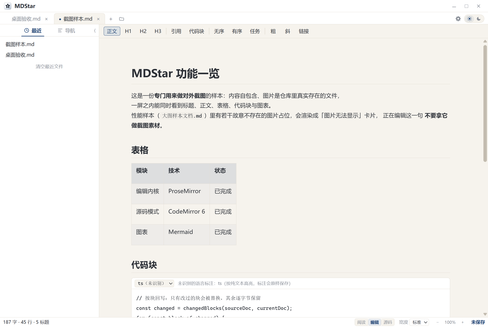
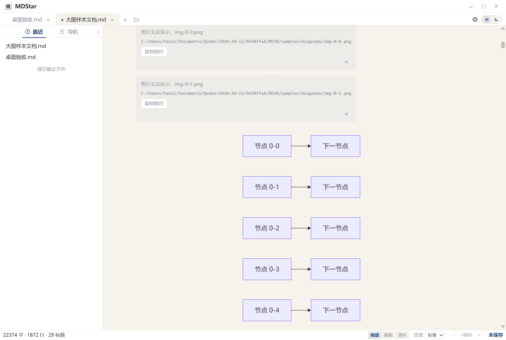
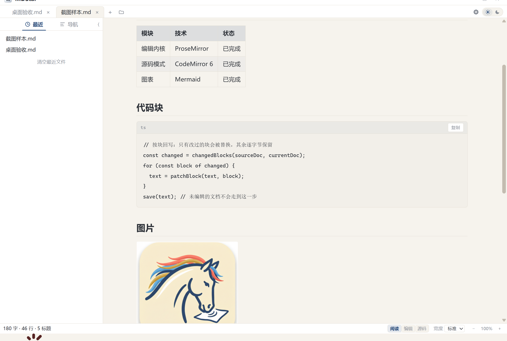
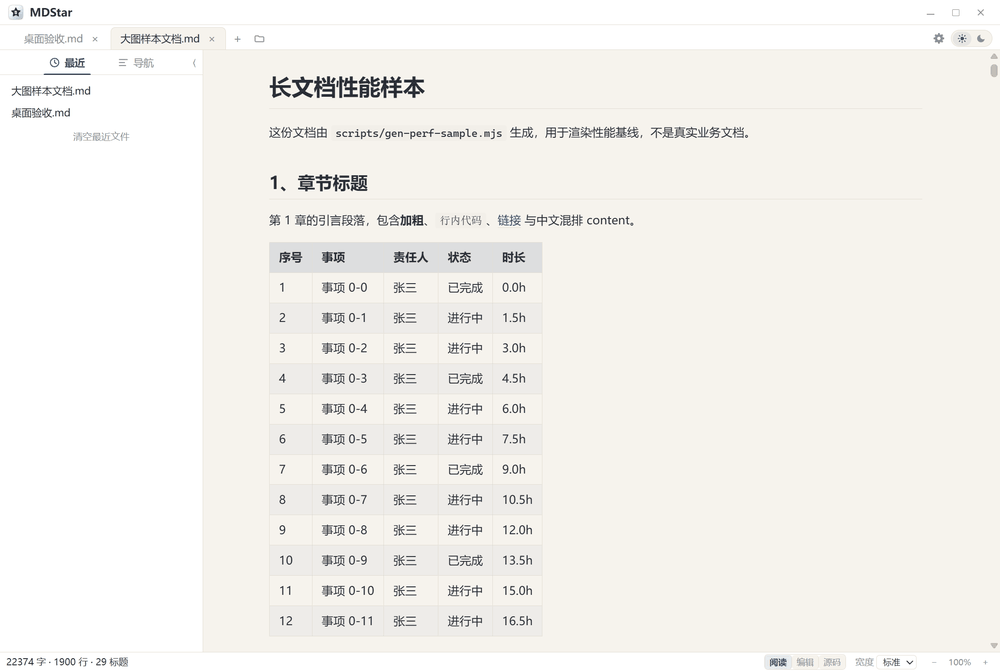

  
  <h1 align="center">MDStar</h1>
  
<b>Markdown Star Browser</b> —— Windows 桌面 Markdown 阅读器 / 编辑器

English documentation: <a href="README.en.md">README.en.md</a>

从 0 自研内核，本地运行不联网。

## 截图

| 阅读模式 | 编辑模式 | Mermaid 渲染 | 代码块 |
| --- | --- | --- | --- |
|  |  |  |  |

**深浅两档主题**（点标签栏齿轮右侧那颗日/月开关）：

## 功能清单

**阅读**

- 多标签打开，阅读 / 编辑 / 源码三档模式
- 侧栏「最近文件」与「导航」大纲，重复标题也能定位到正确那一处
- 整篇缩放（`Ctrl+滚轮`），四种正文宽度
- 深色 / 浅色两档主题
- 图片本地路径解析、失效图给出路径与复制按钮
- 大图双击进灯箱：滚轮缩放、拖拽平移、一键适应屏幕
- 代码块折叠、行号、一键复制、语言标注
- 字数统计

**编辑**

- 点哪儿改哪儿：段落、标题、列表、任务清单、引用、表格单元格、代码块就地编辑
- 输入 Markdown 语法即时转换块类型（`## ` 变标题、`- [ ]` 变任务项），另有格式工具栏
- 表格结构操作：增删行列、移动、设表头
- 撤销有粒度：打字自动合并，结构操作各算一步，「替换全部」一步退回
- 三档模式来回切不丢状态：各自的滚动位置、选区、撤销栈都保留
- 查找与替换，三档模式行为一致（计数与高亮始终对得上）

**Mermaid**

- 常用图类型全渲染，长中文标签自动折行、不溢出、字不糊
- 图上双击直接改字：节点、连线标签、ER 图属性与关系、状态图迁移描述
  —— 回车或失焦提交，Esc 取消，一次撤销退回
- 定位不到源码里的唯一出处时明确拒绝并说明原因，不猜位置

**粘贴**

- 浏览器 / Word 富文本 → 转成干净的 Markdown
- Excel / WPS 复制区域 → 转成表格；粘进已有表格时按列数补齐合并
- 截图 `Ctrl+V` → 图片写入文档同级 `assets/`，正文插相对路径，按内容去重，不覆盖同名文件

**文件与窗口**

- 无边框窗口 + 自绘最小化 / 最大化 / 关闭三键，可收起侧栏
- 新建未命名文档、另存为自动排重（`未命名-2.md`）
- 崩溃快照与恢复、会话恢复、未保存改动关闭提示
- 双击 `.md` 直接打开；已开着实例时再双击第二个文件不新开进程，转交给当前窗口

## 平台与安装

- 仅支持 **Windows 10 / 11（x64）**
- 安装包为**当前用户安装，不弹 UAC**，装到 `%LOCALAPPDATA%\Programs\MDStar`
- 可选把 `.md` / `.markdown` 设为默认打开方式（不勾则只在右键「打开方式」里可选，卸载时还原）
- 依赖 Microsoft Edge WebView2 运行时（Win10/11 一般自带，缺失时安装器会提示）
- 也可以不用安装包：直接运行 `MDStar.exe`（前端资源与图标都内嵌）
- 用户数据存在 `%APPDATA%\mdsb`，卸载时默认保留

## 技术栈

Wails v3（Go）+ WebView2 · ProseMirror（自研 schema 与映射层）· CodeMirror 6 · Mermaid · remark/mdast · NSIS 3

## 暂不支持

- 源码模式暂不吃整篇缩放
- 阅读模式是只读档（改内容用编辑或源码模式）；代码块暂不做语法高亮
- 已有图片的 alt / 路径需在源码模式修改
- 未命名文档（还没保存过）没有崩溃快照与跨重启保留
- 长文档（90 KB 以上）进入编辑模式会有 1~2 秒等待
- 无 macOS / Linux 版本；不做插件机制、导出 Word/PDF、多窗口、LaTeX

## 许可

[MIT](LICENSE)。第三方组件（Wails、ProseMirror、CodeMirror、Mermaid、remark 生态）各自的
MIT 版权声明随依赖保留。
