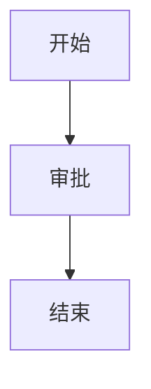

# 审批时效对齐核对报告

编制人：xuange 版本：v1.46

## 一、口径

**指标口径**已对齐，*慢单*定义为超过 `P90` 的工单，见 [口径说明](https://example.com/kou?v=1)。

- 甲项
- 乙项
  - 乙的子项

1. 第一
1. 第二

- [ ] 慢单需要单独看板
- [x] 已提交的清单不再变更

## 二、数据

> 受理量以工单系统导出为准。
>
> 复核人：班组长按钮，不做二次确认。

---

```sql
SELECT matter_type, AVG(diff) AS avg_hours
FROM approval_duration
GROUP BY matter_type;
```

| 科室 | 受理量 | 说明 |
| :--- | ---: | :---: |
| 采油作业区 | 1,234 | 白天班<br>夜间班 |
| 集输作业区 | 56 | 备注 |




<div class="notice">这里有一段裸 HTML，里面写着「不能被丢」</div>

## 三、结论

**结论段落要改的就是这一句。**

其余全段落、列表、表格、代码块、图、HTML、分割线都必须逐字节回来。
