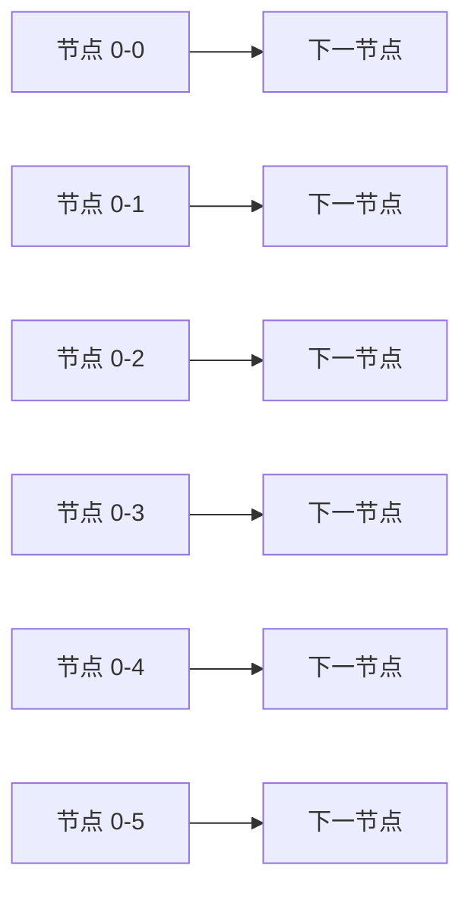
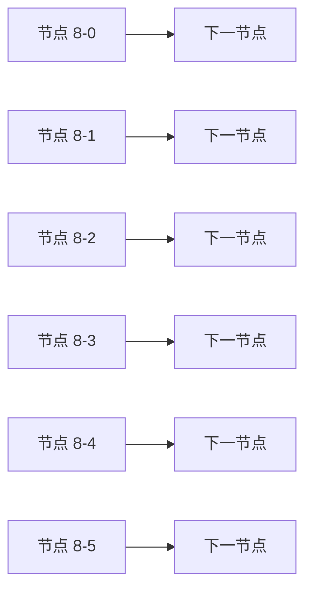
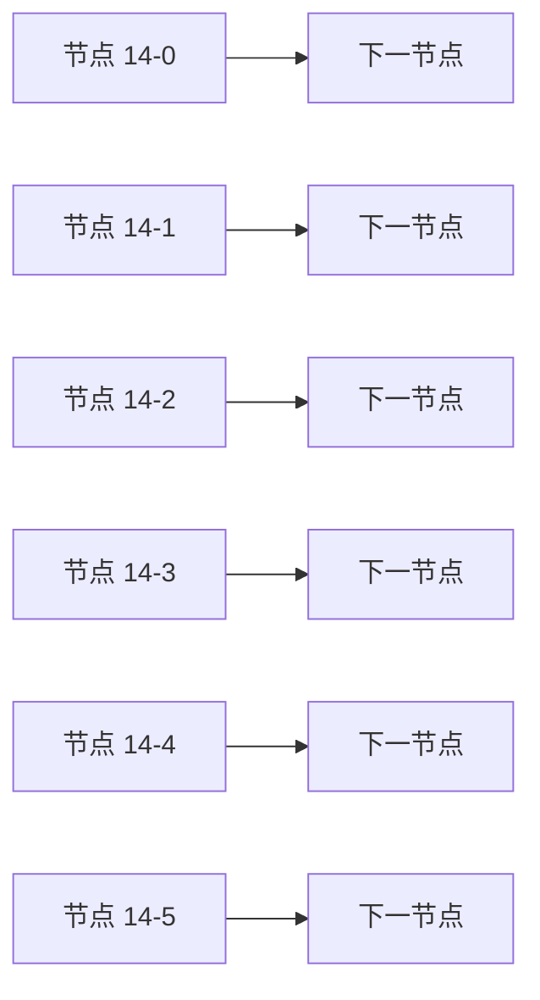
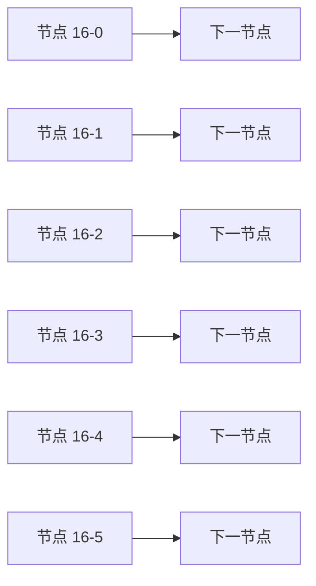
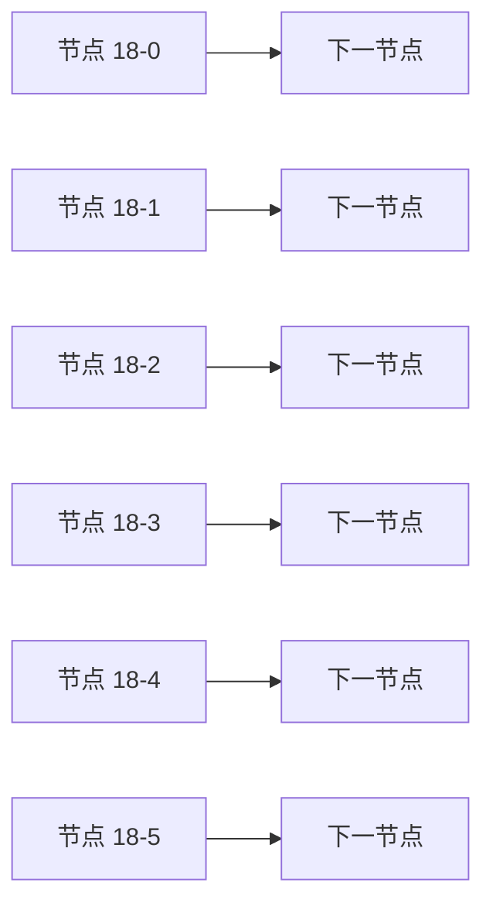
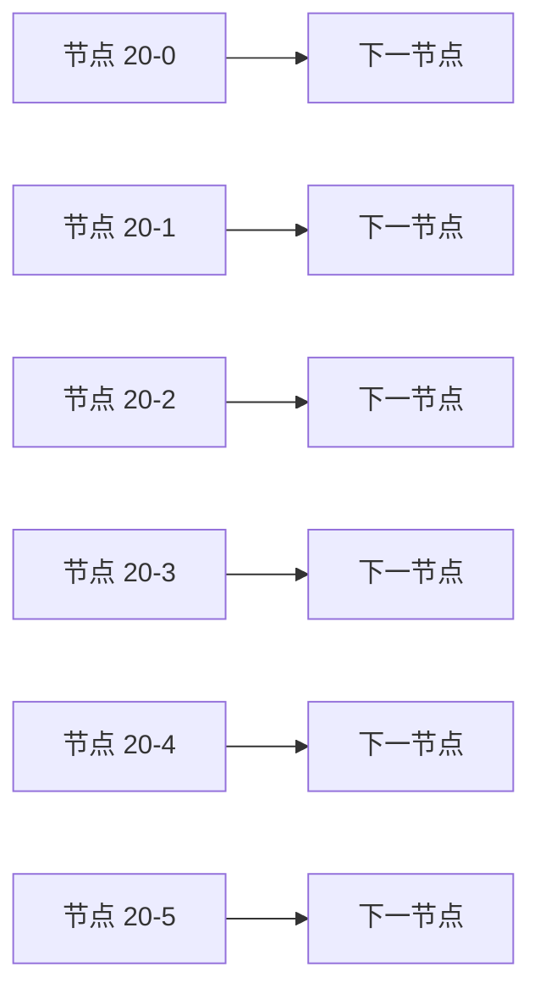
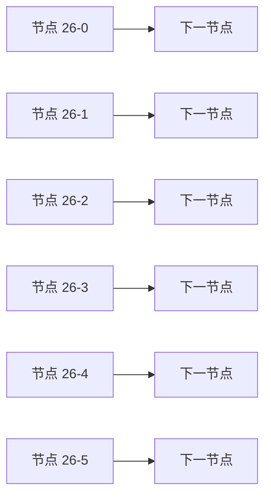

# 长文档性能样本

这份文档由 `scripts/gen-perf-sample.mjs` 生成，用于渲染性能基线，不是真实业务文档。

## 1、章节标题

第 1 章的引言段落，包含**加粗**、`行内代码`、[链接](https://example.com/0) 与中文混排 content。

| 序号 | 事项 | 责任人 | 状态 | 时长 |
| --- | --- | --- | --- | --- |
| 1 | 事项 0-0 | 张三 | 已完成 | 0.0h |
| 2 | 事项 0-1 | 张三 | 进行中 | 1.5h |
| 3 | 事项 0-2 | 张三 | 进行中 | 3.0h |
| 4 | 事项 0-3 | 张三 | 已完成 | 4.5h |
| 5 | 事项 0-4 | 张三 | 进行中 | 6.0h |
| 6 | 事项 0-5 | 张三 | 进行中 | 7.5h |
| 7 | 事项 0-6 | 张三 | 已完成 | 9.0h |
| 8 | 事项 0-7 | 张三 | 进行中 | 10.5h |
| 9 | 事项 0-8 | 张三 | 进行中 | 12.0h |
| 10 | 事项 0-9 | 张三 | 已完成 | 13.5h |
| 11 | 事项 0-10 | 张三 | 进行中 | 15.0h |
| 12 | 事项 0-11 | 张三 | 进行中 | 16.5h |

段落 0-0：这里是一段较长的中文正文，用来制造真实的排版与折行压力。补充内容。补充内容。补充内容。补充内容。补充内容。补充内容。补充内容。补充内容。

段落 0-1：这里是一段较长的中文正文，用来制造真实的排版与折行压力。补充内容。补充内容。补充内容。补充内容。补充内容。补充内容。补充内容。补充内容。

段落 0-2：这里是一段较长的中文正文，用来制造真实的排版与折行压力。补充内容。补充内容。补充内容。补充内容。补充内容。补充内容。补充内容。补充内容。

段落 0-3：这里是一段较长的中文正文，用来制造真实的排版与折行压力。补充内容。补充内容。补充内容。补充内容。补充内容。补充内容。补充内容。补充内容。

段落 0-4：这里是一段较长的中文正文，用来制造真实的排版与折行压力。补充内容。补充内容。补充内容。补充内容。补充内容。补充内容。补充内容。补充内容。

段落 0-5：这里是一段较长的中文正文，用来制造真实的排版与折行压力。补充内容。补充内容。补充内容。补充内容。补充内容。补充内容。补充内容。补充内容。

段落 0-6：这里是一段较长的中文正文，用来制造真实的排版与折行压力。补充内容。补充内容。补充内容。补充内容。补充内容。补充内容。补充内容。补充内容。

段落 0-7：这里是一段较长的中文正文，用来制造真实的排版与折行压力。补充内容。补充内容。补充内容。补充内容。补充内容。补充内容。补充内容。补充内容。

段落 0-8：这里是一段较长的中文正文，用来制造真实的排版与折行压力。补充内容。补充内容。补充内容。补充内容。补充内容。补充内容。补充内容。补充内容。

段落 0-9：这里是一段较长的中文正文，用来制造真实的排版与折行压力。补充内容。补充内容。补充内容。补充内容。补充内容。补充内容。补充内容。补充内容。

- 列表项一
- 列表项二
  - 嵌套项
    - 更深层
- [x] 已完成项
- [ ] 未完成项

> 引用块，跨两行。
> 第二行。

```ts
export const section0 = {
  key0: 0,
  key1: 1,
  key2: 2,
  key3: 3,
  key4: 4,
  key5: 5,
  key6: 6,
  key7: 7,
};
```




## 2、章节标题

第 2 章的引言段落，包含**加粗**、`行内代码`、[链接](https://example.com/1) 与中文混排 content。

| 序号 | 事项 | 责任人 | 状态 | 时长 |
| --- | --- | --- | --- | --- |
| 1 | 事项 1-0 | 张三 | 已完成 | 0.0h |
| 2 | 事项 1-1 | 张三 | 进行中 | 1.5h |
| 3 | 事项 1-2 | 张三 | 进行中 | 3.0h |
| 4 | 事项 1-3 | 张三 | 已完成 | 4.5h |
| 5 | 事项 1-4 | 张三 | 进行中 | 6.0h |
| 6 | 事项 1-5 | 张三 | 进行中 | 7.5h |
| 7 | 事项 1-6 | 张三 | 已完成 | 9.0h |
| 8 | 事项 1-7 | 张三 | 进行中 | 10.5h |
| 9 | 事项 1-8 | 张三 | 进行中 | 12.0h |
| 10 | 事项 1-9 | 张三 | 已完成 | 13.5h |
| 11 | 事项 1-10 | 张三 | 进行中 | 15.0h |
| 12 | 事项 1-11 | 张三 | 进行中 | 16.5h |

段落 1-0：这里是一段较长的中文正文，用来制造真实的排版与折行压力。补充内容。补充内容。补充内容。补充内容。补充内容。补充内容。补充内容。补充内容。

段落 1-1：这里是一段较长的中文正文，用来制造真实的排版与折行压力。补充内容。补充内容。补充内容。补充内容。补充内容。补充内容。补充内容。补充内容。

段落 1-2：这里是一段较长的中文正文，用来制造真实的排版与折行压力。补充内容。补充内容。补充内容。补充内容。补充内容。补充内容。补充内容。补充内容。

段落 1-3：这里是一段较长的中文正文，用来制造真实的排版与折行压力。补充内容。补充内容。补充内容。补充内容。补充内容。补充内容。补充内容。补充内容。

段落 1-4：这里是一段较长的中文正文，用来制造真实的排版与折行压力。补充内容。补充内容。补充内容。补充内容。补充内容。补充内容。补充内容。补充内容。

段落 1-5：这里是一段较长的中文正文，用来制造真实的排版与折行压力。补充内容。补充内容。补充内容。补充内容。补充内容。补充内容。补充内容。补充内容。

段落 1-6：这里是一段较长的中文正文，用来制造真实的排版与折行压力。补充内容。补充内容。补充内容。补充内容。补充内容。补充内容。补充内容。补充内容。

段落 1-7：这里是一段较长的中文正文，用来制造真实的排版与折行压力。补充内容。补充内容。补充内容。补充内容。补充内容。补充内容。补充内容。补充内容。

段落 1-8：这里是一段较长的中文正文，用来制造真实的排版与折行压力。补充内容。补充内容。补充内容。补充内容。补充内容。补充内容。补充内容。补充内容。

段落 1-9：这里是一段较长的中文正文，用来制造真实的排版与折行压力。补充内容。补充内容。补充内容。补充内容。补充内容。补充内容。补充内容。补充内容。

- 列表项一
- 列表项二
  - 嵌套项
    - 更深层
- [x] 已完成项
- [ ] 未完成项

> 引用块，跨两行。
> 第二行。

```ts
export const section1 = {
  key0: 0,
  key1: 1,
  key2: 2,
  key3: 3,
  key4: 4,
  key5: 5,
  key6: 6,
  key7: 7,
};
```

## 3、章节标题

第 3 章的引言段落，包含**加粗**、`行内代码`、[链接](https://example.com/2) 与中文混排 content。

| 序号 | 事项 | 责任人 | 状态 | 时长 |
| --- | --- | --- | --- | --- |
| 1 | 事项 2-0 | 张三 | 已完成 | 0.0h |
| 2 | 事项 2-1 | 张三 | 进行中 | 1.5h |
| 3 | 事项 2-2 | 张三 | 进行中 | 3.0h |
| 4 | 事项 2-3 | 张三 | 已完成 | 4.5h |
| 5 | 事项 2-4 | 张三 | 进行中 | 6.0h |
| 6 | 事项 2-5 | 张三 | 进行中 | 7.5h |
| 7 | 事项 2-6 | 张三 | 已完成 | 9.0h |
| 8 | 事项 2-7 | 张三 | 进行中 | 10.5h |
| 9 | 事项 2-8 | 张三 | 进行中 | 12.0h |
| 10 | 事项 2-9 | 张三 | 已完成 | 13.5h |
| 11 | 事项 2-10 | 张三 | 进行中 | 15.0h |
| 12 | 事项 2-11 | 张三 | 进行中 | 16.5h |

段落 2-0：这里是一段较长的中文正文，用来制造真实的排版与折行压力。补充内容。补充内容。补充内容。补充内容。补充内容。补充内容。补充内容。补充内容。

段落 2-1：这里是一段较长的中文正文，用来制造真实的排版与折行压力。补充内容。补充内容。补充内容。补充内容。补充内容。补充内容。补充内容。补充内容。

段落 2-2：这里是一段较长的中文正文，用来制造真实的排版与折行压力。补充内容。补充内容。补充内容。补充内容。补充内容。补充内容。补充内容。补充内容。

段落 2-3：这里是一段较长的中文正文，用来制造真实的排版与折行压力。补充内容。补充内容。补充内容。补充内容。补充内容。补充内容。补充内容。补充内容。

段落 2-4：这里是一段较长的中文正文，用来制造真实的排版与折行压力。补充内容。补充内容。补充内容。补充内容。补充内容。补充内容。补充内容。补充内容。

段落 2-5：这里是一段较长的中文正文，用来制造真实的排版与折行压力。补充内容。补充内容。补充内容。补充内容。补充内容。补充内容。补充内容。补充内容。

段落 2-6：这里是一段较长的中文正文，用来制造真实的排版与折行压力。补充内容。补充内容。补充内容。补充内容。补充内容。补充内容。补充内容。补充内容。

段落 2-7：这里是一段较长的中文正文，用来制造真实的排版与折行压力。补充内容。补充内容。补充内容。补充内容。补充内容。补充内容。补充内容。补充内容。

段落 2-8：这里是一段较长的中文正文，用来制造真实的排版与折行压力。补充内容。补充内容。补充内容。补充内容。补充内容。补充内容。补充内容。补充内容。

段落 2-9：这里是一段较长的中文正文，用来制造真实的排版与折行压力。补充内容。补充内容。补充内容。补充内容。补充内容。补充内容。补充内容。补充内容。

- 列表项一
- 列表项二
  - 嵌套项
    - 更深层
- [x] 已完成项
- [ ] 未完成项

> 引用块，跨两行。
> 第二行。

```ts
export const section2 = {
  key0: 0,
  key1: 1,
  key2: 2,
  key3: 3,
  key4: 4,
  key5: 5,
  key6: 6,
  key7: 7,
};
```


## 4、章节标题

第 4 章的引言段落，包含**加粗**、`行内代码`、[链接](https://example.com/3) 与中文混排 content。

| 序号 | 事项 | 责任人 | 状态 | 时长 |
| --- | --- | --- | --- | --- |
| 1 | 事项 3-0 | 张三 | 已完成 | 0.0h |
| 2 | 事项 3-1 | 张三 | 进行中 | 1.5h |
| 3 | 事项 3-2 | 张三 | 进行中 | 3.0h |
| 4 | 事项 3-3 | 张三 | 已完成 | 4.5h |
| 5 | 事项 3-4 | 张三 | 进行中 | 6.0h |
| 6 | 事项 3-5 | 张三 | 进行中 | 7.5h |
| 7 | 事项 3-6 | 张三 | 已完成 | 9.0h |
| 8 | 事项 3-7 | 张三 | 进行中 | 10.5h |
| 9 | 事项 3-8 | 张三 | 进行中 | 12.0h |
| 10 | 事项 3-9 | 张三 | 已完成 | 13.5h |
| 11 | 事项 3-10 | 张三 | 进行中 | 15.0h |
| 12 | 事项 3-11 | 张三 | 进行中 | 16.5h |

段落 3-0：这里是一段较长的中文正文，用来制造真实的排版与折行压力。补充内容。补充内容。补充内容。补充内容。补充内容。补充内容。补充内容。补充内容。

段落 3-1：这里是一段较长的中文正文，用来制造真实的排版与折行压力。补充内容。补充内容。补充内容。补充内容。补充内容。补充内容。补充内容。补充内容。

段落 3-2：这里是一段较长的中文正文，用来制造真实的排版与折行压力。补充内容。补充内容。补充内容。补充内容。补充内容。补充内容。补充内容。补充内容。

段落 3-3：这里是一段较长的中文正文，用来制造真实的排版与折行压力。补充内容。补充内容。补充内容。补充内容。补充内容。补充内容。补充内容。补充内容。

段落 3-4：这里是一段较长的中文正文，用来制造真实的排版与折行压力。补充内容。补充内容。补充内容。补充内容。补充内容。补充内容。补充内容。补充内容。

段落 3-5：这里是一段较长的中文正文，用来制造真实的排版与折行压力。补充内容。补充内容。补充内容。补充内容。补充内容。补充内容。补充内容。补充内容。

段落 3-6：这里是一段较长的中文正文，用来制造真实的排版与折行压力。补充内容。补充内容。补充内容。补充内容。补充内容。补充内容。补充内容。补充内容。

段落 3-7：这里是一段较长的中文正文，用来制造真实的排版与折行压力。补充内容。补充内容。补充内容。补充内容。补充内容。补充内容。补充内容。补充内容。

段落 3-8：这里是一段较长的中文正文，用来制造真实的排版与折行压力。补充内容。补充内容。补充内容。补充内容。补充内容。补充内容。补充内容。补充内容。

段落 3-9：这里是一段较长的中文正文，用来制造真实的排版与折行压力。补充内容。补充内容。补充内容。补充内容。补充内容。补充内容。补充内容。补充内容。

- 列表项一
- 列表项二
  - 嵌套项
    - 更深层
- [x] 已完成项
- [ ] 未完成项

> 引用块，跨两行。
> 第二行。

```ts
export const section3 = {
  key0: 0,
  key1: 1,
  key2: 2,
  key3: 3,
  key4: 4,
  key5: 5,
  key6: 6,
  key7: 7,
};
```

## 5、章节标题

第 5 章的引言段落，包含**加粗**、`行内代码`、[链接](https://example.com/4) 与中文混排 content。

| 序号 | 事项 | 责任人 | 状态 | 时长 |
| --- | --- | --- | --- | --- |
| 1 | 事项 4-0 | 张三 | 已完成 | 0.0h |
| 2 | 事项 4-1 | 张三 | 进行中 | 1.5h |
| 3 | 事项 4-2 | 张三 | 进行中 | 3.0h |
| 4 | 事项 4-3 | 张三 | 已完成 | 4.5h |
| 5 | 事项 4-4 | 张三 | 进行中 | 6.0h |
| 6 | 事项 4-5 | 张三 | 进行中 | 7.5h |
| 7 | 事项 4-6 | 张三 | 已完成 | 9.0h |
| 8 | 事项 4-7 | 张三 | 进行中 | 10.5h |
| 9 | 事项 4-8 | 张三 | 进行中 | 12.0h |
| 10 | 事项 4-9 | 张三 | 已完成 | 13.5h |
| 11 | 事项 4-10 | 张三 | 进行中 | 15.0h |
| 12 | 事项 4-11 | 张三 | 进行中 | 16.5h |

段落 4-0：这里是一段较长的中文正文，用来制造真实的排版与折行压力。补充内容。补充内容。补充内容。补充内容。补充内容。补充内容。补充内容。补充内容。

段落 4-1：这里是一段较长的中文正文，用来制造真实的排版与折行压力。补充内容。补充内容。补充内容。补充内容。补充内容。补充内容。补充内容。补充内容。

段落 4-2：这里是一段较长的中文正文，用来制造真实的排版与折行压力。补充内容。补充内容。补充内容。补充内容。补充内容。补充内容。补充内容。补充内容。

段落 4-3：这里是一段较长的中文正文，用来制造真实的排版与折行压力。补充内容。补充内容。补充内容。补充内容。补充内容。补充内容。补充内容。补充内容。

段落 4-4：这里是一段较长的中文正文，用来制造真实的排版与折行压力。补充内容。补充内容。补充内容。补充内容。补充内容。补充内容。补充内容。补充内容。

段落 4-5：这里是一段较长的中文正文，用来制造真实的排版与折行压力。补充内容。补充内容。补充内容。补充内容。补充内容。补充内容。补充内容。补充内容。

段落 4-6：这里是一段较长的中文正文，用来制造真实的排版与折行压力。补充内容。补充内容。补充内容。补充内容。补充内容。补充内容。补充内容。补充内容。

段落 4-7：这里是一段较长的中文正文，用来制造真实的排版与折行压力。补充内容。补充内容。补充内容。补充内容。补充内容。补充内容。补充内容。补充内容。

段落 4-8：这里是一段较长的中文正文，用来制造真实的排版与折行压力。补充内容。补充内容。补充内容。补充内容。补充内容。补充内容。补充内容。补充内容。

段落 4-9：这里是一段较长的中文正文，用来制造真实的排版与折行压力。补充内容。补充内容。补充内容。补充内容。补充内容。补充内容。补充内容。补充内容。

- 列表项一
- 列表项二
  - 嵌套项
    - 更深层
- [x] 已完成项
- [ ] 未完成项

> 引用块，跨两行。
> 第二行。

```ts
export const section4 = {
  key0: 0,
  key1: 1,
  key2: 2,
  key3: 3,
  key4: 4,
  key5: 5,
  key6: 6,
  key7: 7,
};
```


## 6、章节标题

第 6 章的引言段落，包含**加粗**、`行内代码`、[链接](https://example.com/5) 与中文混排 content。

| 序号 | 事项 | 责任人 | 状态 | 时长 |
| --- | --- | --- | --- | --- |
| 1 | 事项 5-0 | 张三 | 已完成 | 0.0h |
| 2 | 事项 5-1 | 张三 | 进行中 | 1.5h |
| 3 | 事项 5-2 | 张三 | 进行中 | 3.0h |
| 4 | 事项 5-3 | 张三 | 已完成 | 4.5h |
| 5 | 事项 5-4 | 张三 | 进行中 | 6.0h |
| 6 | 事项 5-5 | 张三 | 进行中 | 7.5h |
| 7 | 事项 5-6 | 张三 | 已完成 | 9.0h |
| 8 | 事项 5-7 | 张三 | 进行中 | 10.5h |
| 9 | 事项 5-8 | 张三 | 进行中 | 12.0h |
| 10 | 事项 5-9 | 张三 | 已完成 | 13.5h |
| 11 | 事项 5-10 | 张三 | 进行中 | 15.0h |
| 12 | 事项 5-11 | 张三 | 进行中 | 16.5h |

段落 5-0：这里是一段较长的中文正文，用来制造真实的排版与折行压力。补充内容。补充内容。补充内容。补充内容。补充内容。补充内容。补充内容。补充内容。

段落 5-1：这里是一段较长的中文正文，用来制造真实的排版与折行压力。补充内容。补充内容。补充内容。补充内容。补充内容。补充内容。补充内容。补充内容。

段落 5-2：这里是一段较长的中文正文，用来制造真实的排版与折行压力。补充内容。补充内容。补充内容。补充内容。补充内容。补充内容。补充内容。补充内容。

段落 5-3：这里是一段较长的中文正文，用来制造真实的排版与折行压力。补充内容。补充内容。补充内容。补充内容。补充内容。补充内容。补充内容。补充内容。

段落 5-4：这里是一段较长的中文正文，用来制造真实的排版与折行压力。补充内容。补充内容。补充内容。补充内容。补充内容。补充内容。补充内容。补充内容。

段落 5-5：这里是一段较长的中文正文，用来制造真实的排版与折行压力。补充内容。补充内容。补充内容。补充内容。补充内容。补充内容。补充内容。补充内容。

段落 5-6：这里是一段较长的中文正文，用来制造真实的排版与折行压力。补充内容。补充内容。补充内容。补充内容。补充内容。补充内容。补充内容。补充内容。

段落 5-7：这里是一段较长的中文正文，用来制造真实的排版与折行压力。补充内容。补充内容。补充内容。补充内容。补充内容。补充内容。补充内容。补充内容。

段落 5-8：这里是一段较长的中文正文，用来制造真实的排版与折行压力。补充内容。补充内容。补充内容。补充内容。补充内容。补充内容。补充内容。补充内容。

段落 5-9：这里是一段较长的中文正文，用来制造真实的排版与折行压力。补充内容。补充内容。补充内容。补充内容。补充内容。补充内容。补充内容。补充内容。

- 列表项一
- 列表项二
  - 嵌套项
    - 更深层
- [x] 已完成项
- [ ] 未完成项

> 引用块，跨两行。
> 第二行。

```ts
export const section5 = {
  key0: 0,
  key1: 1,
  key2: 2,
  key3: 3,
  key4: 4,
  key5: 5,
  key6: 6,
  key7: 7,
};
```

## 7、章节标题

第 7 章的引言段落，包含**加粗**、`行内代码`、[链接](https://example.com/6) 与中文混排 content。

| 序号 | 事项 | 责任人 | 状态 | 时长 |
| --- | --- | --- | --- | --- |
| 1 | 事项 6-0 | 张三 | 已完成 | 0.0h |
| 2 | 事项 6-1 | 张三 | 进行中 | 1.5h |
| 3 | 事项 6-2 | 张三 | 进行中 | 3.0h |
| 4 | 事项 6-3 | 张三 | 已完成 | 4.5h |
| 5 | 事项 6-4 | 张三 | 进行中 | 6.0h |
| 6 | 事项 6-5 | 张三 | 进行中 | 7.5h |
| 7 | 事项 6-6 | 张三 | 已完成 | 9.0h |
| 8 | 事项 6-7 | 张三 | 进行中 | 10.5h |
| 9 | 事项 6-8 | 张三 | 进行中 | 12.0h |
| 10 | 事项 6-9 | 张三 | 已完成 | 13.5h |
| 11 | 事项 6-10 | 张三 | 进行中 | 15.0h |
| 12 | 事项 6-11 | 张三 | 进行中 | 16.5h |

段落 6-0：这里是一段较长的中文正文，用来制造真实的排版与折行压力。补充内容。补充内容。补充内容。补充内容。补充内容。补充内容。补充内容。补充内容。

段落 6-1：这里是一段较长的中文正文，用来制造真实的排版与折行压力。补充内容。补充内容。补充内容。补充内容。补充内容。补充内容。补充内容。补充内容。

段落 6-2：这里是一段较长的中文正文，用来制造真实的排版与折行压力。补充内容。补充内容。补充内容。补充内容。补充内容。补充内容。补充内容。补充内容。

段落 6-3：这里是一段较长的中文正文，用来制造真实的排版与折行压力。补充内容。补充内容。补充内容。补充内容。补充内容。补充内容。补充内容。补充内容。

段落 6-4：这里是一段较长的中文正文，用来制造真实的排版与折行压力。补充内容。补充内容。补充内容。补充内容。补充内容。补充内容。补充内容。补充内容。

段落 6-5：这里是一段较长的中文正文，用来制造真实的排版与折行压力。补充内容。补充内容。补充内容。补充内容。补充内容。补充内容。补充内容。补充内容。

段落 6-6：这里是一段较长的中文正文，用来制造真实的排版与折行压力。补充内容。补充内容。补充内容。补充内容。补充内容。补充内容。补充内容。补充内容。

段落 6-7：这里是一段较长的中文正文，用来制造真实的排版与折行压力。补充内容。补充内容。补充内容。补充内容。补充内容。补充内容。补充内容。补充内容。

段落 6-8：这里是一段较长的中文正文，用来制造真实的排版与折行压力。补充内容。补充内容。补充内容。补充内容。补充内容。补充内容。补充内容。补充内容。

段落 6-9：这里是一段较长的中文正文，用来制造真实的排版与折行压力。补充内容。补充内容。补充内容。补充内容。补充内容。补充内容。补充内容。补充内容。

- 列表项一
- 列表项二
  - 嵌套项
    - 更深层
- [x] 已完成项
- [ ] 未完成项

> 引用块，跨两行。
> 第二行。

```ts
export const section6 = {
  key0: 0,
  key1: 1,
  key2: 2,
  key3: 3,
  key4: 4,
  key5: 5,
  key6: 6,
  key7: 7,
};
```


## 8、章节标题

第 8 章的引言段落，包含**加粗**、`行内代码`、[链接](https://example.com/7) 与中文混排 content。

| 序号 | 事项 | 责任人 | 状态 | 时长 |
| --- | --- | --- | --- | --- |
| 1 | 事项 7-0 | 张三 | 已完成 | 0.0h |
| 2 | 事项 7-1 | 张三 | 进行中 | 1.5h |
| 3 | 事项 7-2 | 张三 | 进行中 | 3.0h |
| 4 | 事项 7-3 | 张三 | 已完成 | 4.5h |
| 5 | 事项 7-4 | 张三 | 进行中 | 6.0h |
| 6 | 事项 7-5 | 张三 | 进行中 | 7.5h |
| 7 | 事项 7-6 | 张三 | 已完成 | 9.0h |
| 8 | 事项 7-7 | 张三 | 进行中 | 10.5h |
| 9 | 事项 7-8 | 张三 | 进行中 | 12.0h |
| 10 | 事项 7-9 | 张三 | 已完成 | 13.5h |
| 11 | 事项 7-10 | 张三 | 进行中 | 15.0h |
| 12 | 事项 7-11 | 张三 | 进行中 | 16.5h |

段落 7-0：这里是一段较长的中文正文，用来制造真实的排版与折行压力。补充内容。补充内容。补充内容。补充内容。补充内容。补充内容。补充内容。补充内容。

段落 7-1：这里是一段较长的中文正文，用来制造真实的排版与折行压力。补充内容。补充内容。补充内容。补充内容。补充内容。补充内容。补充内容。补充内容。

段落 7-2：这里是一段较长的中文正文，用来制造真实的排版与折行压力。补充内容。补充内容。补充内容。补充内容。补充内容。补充内容。补充内容。补充内容。

段落 7-3：这里是一段较长的中文正文，用来制造真实的排版与折行压力。补充内容。补充内容。补充内容。补充内容。补充内容。补充内容。补充内容。补充内容。

段落 7-4：这里是一段较长的中文正文，用来制造真实的排版与折行压力。补充内容。补充内容。补充内容。补充内容。补充内容。补充内容。补充内容。补充内容。

段落 7-5：这里是一段较长的中文正文，用来制造真实的排版与折行压力。补充内容。补充内容。补充内容。补充内容。补充内容。补充内容。补充内容。补充内容。

段落 7-6：这里是一段较长的中文正文，用来制造真实的排版与折行压力。补充内容。补充内容。补充内容。补充内容。补充内容。补充内容。补充内容。补充内容。

段落 7-7：这里是一段较长的中文正文，用来制造真实的排版与折行压力。补充内容。补充内容。补充内容。补充内容。补充内容。补充内容。补充内容。补充内容。

段落 7-8：这里是一段较长的中文正文，用来制造真实的排版与折行压力。补充内容。补充内容。补充内容。补充内容。补充内容。补充内容。补充内容。补充内容。

段落 7-9：这里是一段较长的中文正文，用来制造真实的排版与折行压力。补充内容。补充内容。补充内容。补充内容。补充内容。补充内容。补充内容。补充内容。

- 列表项一
- 列表项二
  - 嵌套项
    - 更深层
- [x] 已完成项
- [ ] 未完成项

> 引用块，跨两行。
> 第二行。

```ts
export const section7 = {
  key0: 0,
  key1: 1,
  key2: 2,
  key3: 3,
  key4: 4,
  key5: 5,
  key6: 6,
  key7: 7,
};
```

## 9、章节标题

第 9 章的引言段落，包含**加粗**、`行内代码`、[链接](https://example.com/8) 与中文混排 content。

| 序号 | 事项 | 责任人 | 状态 | 时长 |
| --- | --- | --- | --- | --- |
| 1 | 事项 8-0 | 张三 | 已完成 | 0.0h |
| 2 | 事项 8-1 | 张三 | 进行中 | 1.5h |
| 3 | 事项 8-2 | 张三 | 进行中 | 3.0h |
| 4 | 事项 8-3 | 张三 | 已完成 | 4.5h |
| 5 | 事项 8-4 | 张三 | 进行中 | 6.0h |
| 6 | 事项 8-5 | 张三 | 进行中 | 7.5h |
| 7 | 事项 8-6 | 张三 | 已完成 | 9.0h |
| 8 | 事项 8-7 | 张三 | 进行中 | 10.5h |
| 9 | 事项 8-8 | 张三 | 进行中 | 12.0h |
| 10 | 事项 8-9 | 张三 | 已完成 | 13.5h |
| 11 | 事项 8-10 | 张三 | 进行中 | 15.0h |
| 12 | 事项 8-11 | 张三 | 进行中 | 16.5h |

段落 8-0：这里是一段较长的中文正文，用来制造真实的排版与折行压力。补充内容。补充内容。补充内容。补充内容。补充内容。补充内容。补充内容。补充内容。

段落 8-1：这里是一段较长的中文正文，用来制造真实的排版与折行压力。补充内容。补充内容。补充内容。补充内容。补充内容。补充内容。补充内容。补充内容。

段落 8-2：这里是一段较长的中文正文，用来制造真实的排版与折行压力。补充内容。补充内容。补充内容。补充内容。补充内容。补充内容。补充内容。补充内容。

段落 8-3：这里是一段较长的中文正文，用来制造真实的排版与折行压力。补充内容。补充内容。补充内容。补充内容。补充内容。补充内容。补充内容。补充内容。

段落 8-4：这里是一段较长的中文正文，用来制造真实的排版与折行压力。补充内容。补充内容。补充内容。补充内容。补充内容。补充内容。补充内容。补充内容。

段落 8-5：这里是一段较长的中文正文，用来制造真实的排版与折行压力。补充内容。补充内容。补充内容。补充内容。补充内容。补充内容。补充内容。补充内容。

段落 8-6：这里是一段较长的中文正文，用来制造真实的排版与折行压力。补充内容。补充内容。补充内容。补充内容。补充内容。补充内容。补充内容。补充内容。

段落 8-7：这里是一段较长的中文正文，用来制造真实的排版与折行压力。补充内容。补充内容。补充内容。补充内容。补充内容。补充内容。补充内容。补充内容。

段落 8-8：这里是一段较长的中文正文，用来制造真实的排版与折行压力。补充内容。补充内容。补充内容。补充内容。补充内容。补充内容。补充内容。补充内容。

段落 8-9：这里是一段较长的中文正文，用来制造真实的排版与折行压力。补充内容。补充内容。补充内容。补充内容。补充内容。补充内容。补充内容。补充内容。

- 列表项一
- 列表项二
  - 嵌套项
    - 更深层
- [x] 已完成项
- [ ] 未完成项

> 引用块，跨两行。
> 第二行。

```ts
export const section8 = {
  key0: 0,
  key1: 1,
  key2: 2,
  key3: 3,
  key4: 4,
  key5: 5,
  key6: 6,
  key7: 7,
};
```



## 10、章节标题

第 10 章的引言段落，包含**加粗**、`行内代码`、[链接](https://example.com/9) 与中文混排 content。

| 序号 | 事项 | 责任人 | 状态 | 时长 |
| --- | --- | --- | --- | --- |
| 1 | 事项 9-0 | 张三 | 已完成 | 0.0h |
| 2 | 事项 9-1 | 张三 | 进行中 | 1.5h |
| 3 | 事项 9-2 | 张三 | 进行中 | 3.0h |
| 4 | 事项 9-3 | 张三 | 已完成 | 4.5h |
| 5 | 事项 9-4 | 张三 | 进行中 | 6.0h |
| 6 | 事项 9-5 | 张三 | 进行中 | 7.5h |
| 7 | 事项 9-6 | 张三 | 已完成 | 9.0h |
| 8 | 事项 9-7 | 张三 | 进行中 | 10.5h |
| 9 | 事项 9-8 | 张三 | 进行中 | 12.0h |
| 10 | 事项 9-9 | 张三 | 已完成 | 13.5h |
| 11 | 事项 9-10 | 张三 | 进行中 | 15.0h |
| 12 | 事项 9-11 | 张三 | 进行中 | 16.5h |

段落 9-0：这里是一段较长的中文正文，用来制造真实的排版与折行压力。补充内容。补充内容。补充内容。补充内容。补充内容。补充内容。补充内容。补充内容。

段落 9-1：这里是一段较长的中文正文，用来制造真实的排版与折行压力。补充内容。补充内容。补充内容。补充内容。补充内容。补充内容。补充内容。补充内容。

段落 9-2：这里是一段较长的中文正文，用来制造真实的排版与折行压力。补充内容。补充内容。补充内容。补充内容。补充内容。补充内容。补充内容。补充内容。

段落 9-3：这里是一段较长的中文正文，用来制造真实的排版与折行压力。补充内容。补充内容。补充内容。补充内容。补充内容。补充内容。补充内容。补充内容。

段落 9-4：这里是一段较长的中文正文，用来制造真实的排版与折行压力。补充内容。补充内容。补充内容。补充内容。补充内容。补充内容。补充内容。补充内容。

段落 9-5：这里是一段较长的中文正文，用来制造真实的排版与折行压力。补充内容。补充内容。补充内容。补充内容。补充内容。补充内容。补充内容。补充内容。

段落 9-6：这里是一段较长的中文正文，用来制造真实的排版与折行压力。补充内容。补充内容。补充内容。补充内容。补充内容。补充内容。补充内容。补充内容。

段落 9-7：这里是一段较长的中文正文，用来制造真实的排版与折行压力。补充内容。补充内容。补充内容。补充内容。补充内容。补充内容。补充内容。补充内容。

段落 9-8：这里是一段较长的中文正文，用来制造真实的排版与折行压力。补充内容。补充内容。补充内容。补充内容。补充内容。补充内容。补充内容。补充内容。

段落 9-9：这里是一段较长的中文正文，用来制造真实的排版与折行压力。补充内容。补充内容。补充内容。补充内容。补充内容。补充内容。补充内容。补充内容。

- 列表项一
- 列表项二
  - 嵌套项
    - 更深层
- [x] 已完成项
- [ ] 未完成项

> 引用块，跨两行。
> 第二行。

```ts
export const section9 = {
  key0: 0,
  key1: 1,
  key2: 2,
  key3: 3,
  key4: 4,
  key5: 5,
  key6: 6,
  key7: 7,
};
```

## 11、章节标题

第 11 章的引言段落，包含**加粗**、`行内代码`、[链接](https://example.com/10) 与中文混排 content。

| 序号 | 事项 | 责任人 | 状态 | 时长 |
| --- | --- | --- | --- | --- |
| 1 | 事项 10-0 | 张三 | 已完成 | 0.0h |
| 2 | 事项 10-1 | 张三 | 进行中 | 1.5h |
| 3 | 事项 10-2 | 张三 | 进行中 | 3.0h |
| 4 | 事项 10-3 | 张三 | 已完成 | 4.5h |
| 5 | 事项 10-4 | 张三 | 进行中 | 6.0h |
| 6 | 事项 10-5 | 张三 | 进行中 | 7.5h |
| 7 | 事项 10-6 | 张三 | 已完成 | 9.0h |
| 8 | 事项 10-7 | 张三 | 进行中 | 10.5h |
| 9 | 事项 10-8 | 张三 | 进行中 | 12.0h |
| 10 | 事项 10-9 | 张三 | 已完成 | 13.5h |
| 11 | 事项 10-10 | 张三 | 进行中 | 15.0h |
| 12 | 事项 10-11 | 张三 | 进行中 | 16.5h |

段落 10-0：这里是一段较长的中文正文，用来制造真实的排版与折行压力。补充内容。补充内容。补充内容。补充内容。补充内容。补充内容。补充内容。补充内容。

段落 10-1：这里是一段较长的中文正文，用来制造真实的排版与折行压力。补充内容。补充内容。补充内容。补充内容。补充内容。补充内容。补充内容。补充内容。

段落 10-2：这里是一段较长的中文正文，用来制造真实的排版与折行压力。补充内容。补充内容。补充内容。补充内容。补充内容。补充内容。补充内容。补充内容。

段落 10-3：这里是一段较长的中文正文，用来制造真实的排版与折行压力。补充内容。补充内容。补充内容。补充内容。补充内容。补充内容。补充内容。补充内容。

段落 10-4：这里是一段较长的中文正文，用来制造真实的排版与折行压力。补充内容。补充内容。补充内容。补充内容。补充内容。补充内容。补充内容。补充内容。

段落 10-5：这里是一段较长的中文正文，用来制造真实的排版与折行压力。补充内容。补充内容。补充内容。补充内容。补充内容。补充内容。补充内容。补充内容。

段落 10-6：这里是一段较长的中文正文，用来制造真实的排版与折行压力。补充内容。补充内容。补充内容。补充内容。补充内容。补充内容。补充内容。补充内容。

段落 10-7：这里是一段较长的中文正文，用来制造真实的排版与折行压力。补充内容。补充内容。补充内容。补充内容。补充内容。补充内容。补充内容。补充内容。

段落 10-8：这里是一段较长的中文正文，用来制造真实的排版与折行压力。补充内容。补充内容。补充内容。补充内容。补充内容。补充内容。补充内容。补充内容。

段落 10-9：这里是一段较长的中文正文，用来制造真实的排版与折行压力。补充内容。补充内容。补充内容。补充内容。补充内容。补充内容。补充内容。补充内容。

- 列表项一
- 列表项二
  - 嵌套项
    - 更深层
- [x] 已完成项
- [ ] 未完成项

> 引用块，跨两行。
> 第二行。

```ts
export const section10 = {
  key0: 0,
  key1: 1,
  key2: 2,
  key3: 3,
  key4: 4,
  key5: 5,
  key6: 6,
  key7: 7,
};
```


## 12、章节标题

第 12 章的引言段落，包含**加粗**、`行内代码`、[链接](https://example.com/11) 与中文混排 content。

| 序号 | 事项 | 责任人 | 状态 | 时长 |
| --- | --- | --- | --- | --- |
| 1 | 事项 11-0 | 张三 | 已完成 | 0.0h |
| 2 | 事项 11-1 | 张三 | 进行中 | 1.5h |
| 3 | 事项 11-2 | 张三 | 进行中 | 3.0h |
| 4 | 事项 11-3 | 张三 | 已完成 | 4.5h |
| 5 | 事项 11-4 | 张三 | 进行中 | 6.0h |
| 6 | 事项 11-5 | 张三 | 进行中 | 7.5h |
| 7 | 事项 11-6 | 张三 | 已完成 | 9.0h |
| 8 | 事项 11-7 | 张三 | 进行中 | 10.5h |
| 9 | 事项 11-8 | 张三 | 进行中 | 12.0h |
| 10 | 事项 11-9 | 张三 | 已完成 | 13.5h |
| 11 | 事项 11-10 | 张三 | 进行中 | 15.0h |
| 12 | 事项 11-11 | 张三 | 进行中 | 16.5h |

段落 11-0：这里是一段较长的中文正文，用来制造真实的排版与折行压力。补充内容。补充内容。补充内容。补充内容。补充内容。补充内容。补充内容。补充内容。

段落 11-1：这里是一段较长的中文正文，用来制造真实的排版与折行压力。补充内容。补充内容。补充内容。补充内容。补充内容。补充内容。补充内容。补充内容。

段落 11-2：这里是一段较长的中文正文，用来制造真实的排版与折行压力。补充内容。补充内容。补充内容。补充内容。补充内容。补充内容。补充内容。补充内容。

段落 11-3：这里是一段较长的中文正文，用来制造真实的排版与折行压力。补充内容。补充内容。补充内容。补充内容。补充内容。补充内容。补充内容。补充内容。

段落 11-4：这里是一段较长的中文正文，用来制造真实的排版与折行压力。补充内容。补充内容。补充内容。补充内容。补充内容。补充内容。补充内容。补充内容。

段落 11-5：这里是一段较长的中文正文，用来制造真实的排版与折行压力。补充内容。补充内容。补充内容。补充内容。补充内容。补充内容。补充内容。补充内容。

段落 11-6：这里是一段较长的中文正文，用来制造真实的排版与折行压力。补充内容。补充内容。补充内容。补充内容。补充内容。补充内容。补充内容。补充内容。

段落 11-7：这里是一段较长的中文正文，用来制造真实的排版与折行压力。补充内容。补充内容。补充内容。补充内容。补充内容。补充内容。补充内容。补充内容。

段落 11-8：这里是一段较长的中文正文，用来制造真实的排版与折行压力。补充内容。补充内容。补充内容。补充内容。补充内容。补充内容。补充内容。补充内容。

段落 11-9：这里是一段较长的中文正文，用来制造真实的排版与折行压力。补充内容。补充内容。补充内容。补充内容。补充内容。补充内容。补充内容。补充内容。

- 列表项一
- 列表项二
  - 嵌套项
    - 更深层
- [x] 已完成项
- [ ] 未完成项

> 引用块，跨两行。
> 第二行。

```ts
export const section11 = {
  key0: 0,
  key1: 1,
  key2: 2,
  key3: 3,
  key4: 4,
  key5: 5,
  key6: 6,
  key7: 7,
};
```

## 13、章节标题

第 13 章的引言段落，包含**加粗**、`行内代码`、[链接](https://example.com/12) 与中文混排 content。

| 序号 | 事项 | 责任人 | 状态 | 时长 |
| --- | --- | --- | --- | --- |
| 1 | 事项 12-0 | 张三 | 已完成 | 0.0h |
| 2 | 事项 12-1 | 张三 | 进行中 | 1.5h |
| 3 | 事项 12-2 | 张三 | 进行中 | 3.0h |
| 4 | 事项 12-3 | 张三 | 已完成 | 4.5h |
| 5 | 事项 12-4 | 张三 | 进行中 | 6.0h |
| 6 | 事项 12-5 | 张三 | 进行中 | 7.5h |
| 7 | 事项 12-6 | 张三 | 已完成 | 9.0h |
| 8 | 事项 12-7 | 张三 | 进行中 | 10.5h |
| 9 | 事项 12-8 | 张三 | 进行中 | 12.0h |
| 10 | 事项 12-9 | 张三 | 已完成 | 13.5h |
| 11 | 事项 12-10 | 张三 | 进行中 | 15.0h |
| 12 | 事项 12-11 | 张三 | 进行中 | 16.5h |

段落 12-0：这里是一段较长的中文正文，用来制造真实的排版与折行压力。补充内容。补充内容。补充内容。补充内容。补充内容。补充内容。补充内容。补充内容。

段落 12-1：这里是一段较长的中文正文，用来制造真实的排版与折行压力。补充内容。补充内容。补充内容。补充内容。补充内容。补充内容。补充内容。补充内容。

段落 12-2：这里是一段较长的中文正文，用来制造真实的排版与折行压力。补充内容。补充内容。补充内容。补充内容。补充内容。补充内容。补充内容。补充内容。

段落 12-3：这里是一段较长的中文正文，用来制造真实的排版与折行压力。补充内容。补充内容。补充内容。补充内容。补充内容。补充内容。补充内容。补充内容。

段落 12-4：这里是一段较长的中文正文，用来制造真实的排版与折行压力。补充内容。补充内容。补充内容。补充内容。补充内容。补充内容。补充内容。补充内容。

段落 12-5：这里是一段较长的中文正文，用来制造真实的排版与折行压力。补充内容。补充内容。补充内容。补充内容。补充内容。补充内容。补充内容。补充内容。

段落 12-6：这里是一段较长的中文正文，用来制造真实的排版与折行压力。补充内容。补充内容。补充内容。补充内容。补充内容。补充内容。补充内容。补充内容。

段落 12-7：这里是一段较长的中文正文，用来制造真实的排版与折行压力。补充内容。补充内容。补充内容。补充内容。补充内容。补充内容。补充内容。补充内容。

段落 12-8：这里是一段较长的中文正文，用来制造真实的排版与折行压力。补充内容。补充内容。补充内容。补充内容。补充内容。补充内容。补充内容。补充内容。

段落 12-9：这里是一段较长的中文正文，用来制造真实的排版与折行压力。补充内容。补充内容。补充内容。补充内容。补充内容。补充内容。补充内容。补充内容。

- 列表项一
- 列表项二
  - 嵌套项
    - 更深层
- [x] 已完成项
- [ ] 未完成项

> 引用块，跨两行。
> 第二行。

```ts
export const section12 = {
  key0: 0,
  key1: 1,
  key2: 2,
  key3: 3,
  key4: 4,
  key5: 5,
  key6: 6,
  key7: 7,
};
```


## 14、章节标题

第 14 章的引言段落，包含**加粗**、`行内代码`、[链接](https://example.com/13) 与中文混排 content。

| 序号 | 事项 | 责任人 | 状态 | 时长 |
| --- | --- | --- | --- | --- |
| 1 | 事项 13-0 | 张三 | 已完成 | 0.0h |
| 2 | 事项 13-1 | 张三 | 进行中 | 1.5h |
| 3 | 事项 13-2 | 张三 | 进行中 | 3.0h |
| 4 | 事项 13-3 | 张三 | 已完成 | 4.5h |
| 5 | 事项 13-4 | 张三 | 进行中 | 6.0h |
| 6 | 事项 13-5 | 张三 | 进行中 | 7.5h |
| 7 | 事项 13-6 | 张三 | 已完成 | 9.0h |
| 8 | 事项 13-7 | 张三 | 进行中 | 10.5h |
| 9 | 事项 13-8 | 张三 | 进行中 | 12.0h |
| 10 | 事项 13-9 | 张三 | 已完成 | 13.5h |
| 11 | 事项 13-10 | 张三 | 进行中 | 15.0h |
| 12 | 事项 13-11 | 张三 | 进行中 | 16.5h |

段落 13-0：这里是一段较长的中文正文，用来制造真实的排版与折行压力。补充内容。补充内容。补充内容。补充内容。补充内容。补充内容。补充内容。补充内容。

段落 13-1：这里是一段较长的中文正文，用来制造真实的排版与折行压力。补充内容。补充内容。补充内容。补充内容。补充内容。补充内容。补充内容。补充内容。

段落 13-2：这里是一段较长的中文正文，用来制造真实的排版与折行压力。补充内容。补充内容。补充内容。补充内容。补充内容。补充内容。补充内容。补充内容。

段落 13-3：这里是一段较长的中文正文，用来制造真实的排版与折行压力。补充内容。补充内容。补充内容。补充内容。补充内容。补充内容。补充内容。补充内容。

段落 13-4：这里是一段较长的中文正文，用来制造真实的排版与折行压力。补充内容。补充内容。补充内容。补充内容。补充内容。补充内容。补充内容。补充内容。

段落 13-5：这里是一段较长的中文正文，用来制造真实的排版与折行压力。补充内容。补充内容。补充内容。补充内容。补充内容。补充内容。补充内容。补充内容。

段落 13-6：这里是一段较长的中文正文，用来制造真实的排版与折行压力。补充内容。补充内容。补充内容。补充内容。补充内容。补充内容。补充内容。补充内容。

段落 13-7：这里是一段较长的中文正文，用来制造真实的排版与折行压力。补充内容。补充内容。补充内容。补充内容。补充内容。补充内容。补充内容。补充内容。

段落 13-8：这里是一段较长的中文正文，用来制造真实的排版与折行压力。补充内容。补充内容。补充内容。补充内容。补充内容。补充内容。补充内容。补充内容。

段落 13-9：这里是一段较长的中文正文，用来制造真实的排版与折行压力。补充内容。补充内容。补充内容。补充内容。补充内容。补充内容。补充内容。补充内容。

- 列表项一
- 列表项二
  - 嵌套项
    - 更深层
- [x] 已完成项
- [ ] 未完成项

> 引用块，跨两行。
> 第二行。

```ts
export const section13 = {
  key0: 0,
  key1: 1,
  key2: 2,
  key3: 3,
  key4: 4,
  key5: 5,
  key6: 6,
  key7: 7,
};
```

## 15、章节标题

第 15 章的引言段落，包含**加粗**、`行内代码`、[链接](https://example.com/14) 与中文混排 content。

| 序号 | 事项 | 责任人 | 状态 | 时长 |
| --- | --- | --- | --- | --- |
| 1 | 事项 14-0 | 张三 | 已完成 | 0.0h |
| 2 | 事项 14-1 | 张三 | 进行中 | 1.5h |
| 3 | 事项 14-2 | 张三 | 进行中 | 3.0h |
| 4 | 事项 14-3 | 张三 | 已完成 | 4.5h |
| 5 | 事项 14-4 | 张三 | 进行中 | 6.0h |
| 6 | 事项 14-5 | 张三 | 进行中 | 7.5h |
| 7 | 事项 14-6 | 张三 | 已完成 | 9.0h |
| 8 | 事项 14-7 | 张三 | 进行中 | 10.5h |
| 9 | 事项 14-8 | 张三 | 进行中 | 12.0h |
| 10 | 事项 14-9 | 张三 | 已完成 | 13.5h |
| 11 | 事项 14-10 | 张三 | 进行中 | 15.0h |
| 12 | 事项 14-11 | 张三 | 进行中 | 16.5h |

段落 14-0：这里是一段较长的中文正文，用来制造真实的排版与折行压力。补充内容。补充内容。补充内容。补充内容。补充内容。补充内容。补充内容。补充内容。

段落 14-1：这里是一段较长的中文正文，用来制造真实的排版与折行压力。补充内容。补充内容。补充内容。补充内容。补充内容。补充内容。补充内容。补充内容。

段落 14-2：这里是一段较长的中文正文，用来制造真实的排版与折行压力。补充内容。补充内容。补充内容。补充内容。补充内容。补充内容。补充内容。补充内容。

段落 14-3：这里是一段较长的中文正文，用来制造真实的排版与折行压力。补充内容。补充内容。补充内容。补充内容。补充内容。补充内容。补充内容。补充内容。

段落 14-4：这里是一段较长的中文正文，用来制造真实的排版与折行压力。补充内容。补充内容。补充内容。补充内容。补充内容。补充内容。补充内容。补充内容。

段落 14-5：这里是一段较长的中文正文，用来制造真实的排版与折行压力。补充内容。补充内容。补充内容。补充内容。补充内容。补充内容。补充内容。补充内容。

段落 14-6：这里是一段较长的中文正文，用来制造真实的排版与折行压力。补充内容。补充内容。补充内容。补充内容。补充内容。补充内容。补充内容。补充内容。

段落 14-7：这里是一段较长的中文正文，用来制造真实的排版与折行压力。补充内容。补充内容。补充内容。补充内容。补充内容。补充内容。补充内容。补充内容。

段落 14-8：这里是一段较长的中文正文，用来制造真实的排版与折行压力。补充内容。补充内容。补充内容。补充内容。补充内容。补充内容。补充内容。补充内容。

段落 14-9：这里是一段较长的中文正文，用来制造真实的排版与折行压力。补充内容。补充内容。补充内容。补充内容。补充内容。补充内容。补充内容。补充内容。

- 列表项一
- 列表项二
  - 嵌套项
    - 更深层
- [x] 已完成项
- [ ] 未完成项

> 引用块，跨两行。
> 第二行。

```ts
export const section14 = {
  key0: 0,
  key1: 1,
  key2: 2,
  key3: 3,
  key4: 4,
  key5: 5,
  key6: 6,
  key7: 7,
};
```



## 16、章节标题

第 16 章的引言段落，包含**加粗**、`行内代码`、[链接](https://example.com/15) 与中文混排 content。

| 序号 | 事项 | 责任人 | 状态 | 时长 |
| --- | --- | --- | --- | --- |
| 1 | 事项 15-0 | 张三 | 已完成 | 0.0h |
| 2 | 事项 15-1 | 张三 | 进行中 | 1.5h |
| 3 | 事项 15-2 | 张三 | 进行中 | 3.0h |
| 4 | 事项 15-3 | 张三 | 已完成 | 4.5h |
| 5 | 事项 15-4 | 张三 | 进行中 | 6.0h |
| 6 | 事项 15-5 | 张三 | 进行中 | 7.5h |
| 7 | 事项 15-6 | 张三 | 已完成 | 9.0h |
| 8 | 事项 15-7 | 张三 | 进行中 | 10.5h |
| 9 | 事项 15-8 | 张三 | 进行中 | 12.0h |
| 10 | 事项 15-9 | 张三 | 已完成 | 13.5h |
| 11 | 事项 15-10 | 张三 | 进行中 | 15.0h |
| 12 | 事项 15-11 | 张三 | 进行中 | 16.5h |

段落 15-0：这里是一段较长的中文正文，用来制造真实的排版与折行压力。补充内容。补充内容。补充内容。补充内容。补充内容。补充内容。补充内容。补充内容。

段落 15-1：这里是一段较长的中文正文，用来制造真实的排版与折行压力。补充内容。补充内容。补充内容。补充内容。补充内容。补充内容。补充内容。补充内容。

段落 15-2：这里是一段较长的中文正文，用来制造真实的排版与折行压力。补充内容。补充内容。补充内容。补充内容。补充内容。补充内容。补充内容。补充内容。

段落 15-3：这里是一段较长的中文正文，用来制造真实的排版与折行压力。补充内容。补充内容。补充内容。补充内容。补充内容。补充内容。补充内容。补充内容。

段落 15-4：这里是一段较长的中文正文，用来制造真实的排版与折行压力。补充内容。补充内容。补充内容。补充内容。补充内容。补充内容。补充内容。补充内容。

段落 15-5：这里是一段较长的中文正文，用来制造真实的排版与折行压力。补充内容。补充内容。补充内容。补充内容。补充内容。补充内容。补充内容。补充内容。

段落 15-6：这里是一段较长的中文正文，用来制造真实的排版与折行压力。补充内容。补充内容。补充内容。补充内容。补充内容。补充内容。补充内容。补充内容。

段落 15-7：这里是一段较长的中文正文，用来制造真实的排版与折行压力。补充内容。补充内容。补充内容。补充内容。补充内容。补充内容。补充内容。补充内容。

段落 15-8：这里是一段较长的中文正文，用来制造真实的排版与折行压力。补充内容。补充内容。补充内容。补充内容。补充内容。补充内容。补充内容。补充内容。

段落 15-9：这里是一段较长的中文正文，用来制造真实的排版与折行压力。补充内容。补充内容。补充内容。补充内容。补充内容。补充内容。补充内容。补充内容。

- 列表项一
- 列表项二
  - 嵌套项
    - 更深层
- [x] 已完成项
- [ ] 未完成项

> 引用块，跨两行。
> 第二行。

```ts
export const section15 = {
  key0: 0,
  key1: 1,
  key2: 2,
  key3: 3,
  key4: 4,
  key5: 5,
  key6: 6,
  key7: 7,
};
```

## 17、章节标题

第 17 章的引言段落，包含**加粗**、`行内代码`、[链接](https://example.com/16) 与中文混排 content。

| 序号 | 事项 | 责任人 | 状态 | 时长 |
| --- | --- | --- | --- | --- |
| 1 | 事项 16-0 | 张三 | 已完成 | 0.0h |
| 2 | 事项 16-1 | 张三 | 进行中 | 1.5h |
| 3 | 事项 16-2 | 张三 | 进行中 | 3.0h |
| 4 | 事项 16-3 | 张三 | 已完成 | 4.5h |
| 5 | 事项 16-4 | 张三 | 进行中 | 6.0h |
| 6 | 事项 16-5 | 张三 | 进行中 | 7.5h |
| 7 | 事项 16-6 | 张三 | 已完成 | 9.0h |
| 8 | 事项 16-7 | 张三 | 进行中 | 10.5h |
| 9 | 事项 16-8 | 张三 | 进行中 | 12.0h |
| 10 | 事项 16-9 | 张三 | 已完成 | 13.5h |
| 11 | 事项 16-10 | 张三 | 进行中 | 15.0h |
| 12 | 事项 16-11 | 张三 | 进行中 | 16.5h |

段落 16-0：这里是一段较长的中文正文，用来制造真实的排版与折行压力。补充内容。补充内容。补充内容。补充内容。补充内容。补充内容。补充内容。补充内容。

段落 16-1：这里是一段较长的中文正文，用来制造真实的排版与折行压力。补充内容。补充内容。补充内容。补充内容。补充内容。补充内容。补充内容。补充内容。

段落 16-2：这里是一段较长的中文正文，用来制造真实的排版与折行压力。补充内容。补充内容。补充内容。补充内容。补充内容。补充内容。补充内容。补充内容。

段落 16-3：这里是一段较长的中文正文，用来制造真实的排版与折行压力。补充内容。补充内容。补充内容。补充内容。补充内容。补充内容。补充内容。补充内容。

段落 16-4：这里是一段较长的中文正文，用来制造真实的排版与折行压力。补充内容。补充内容。补充内容。补充内容。补充内容。补充内容。补充内容。补充内容。

段落 16-5：这里是一段较长的中文正文，用来制造真实的排版与折行压力。补充内容。补充内容。补充内容。补充内容。补充内容。补充内容。补充内容。补充内容。

段落 16-6：这里是一段较长的中文正文，用来制造真实的排版与折行压力。补充内容。补充内容。补充内容。补充内容。补充内容。补充内容。补充内容。补充内容。

段落 16-7：这里是一段较长的中文正文，用来制造真实的排版与折行压力。补充内容。补充内容。补充内容。补充内容。补充内容。补充内容。补充内容。补充内容。

段落 16-8：这里是一段较长的中文正文，用来制造真实的排版与折行压力。补充内容。补充内容。补充内容。补充内容。补充内容。补充内容。补充内容。补充内容。

段落 16-9：这里是一段较长的中文正文，用来制造真实的排版与折行压力。补充内容。补充内容。补充内容。补充内容。补充内容。补充内容。补充内容。补充内容。

- 列表项一
- 列表项二
  - 嵌套项
    - 更深层
- [x] 已完成项
- [ ] 未完成项

> 引用块，跨两行。
> 第二行。

```ts
export const section16 = {
  key0: 0,
  key1: 1,
  key2: 2,
  key3: 3,
  key4: 4,
  key5: 5,
  key6: 6,
  key7: 7,
};
```



## 18、章节标题

第 18 章的引言段落，包含**加粗**、`行内代码`、[链接](https://example.com/17) 与中文混排 content。

| 序号 | 事项 | 责任人 | 状态 | 时长 |
| --- | --- | --- | --- | --- |
| 1 | 事项 17-0 | 张三 | 已完成 | 0.0h |
| 2 | 事项 17-1 | 张三 | 进行中 | 1.5h |
| 3 | 事项 17-2 | 张三 | 进行中 | 3.0h |
| 4 | 事项 17-3 | 张三 | 已完成 | 4.5h |
| 5 | 事项 17-4 | 张三 | 进行中 | 6.0h |
| 6 | 事项 17-5 | 张三 | 进行中 | 7.5h |
| 7 | 事项 17-6 | 张三 | 已完成 | 9.0h |
| 8 | 事项 17-7 | 张三 | 进行中 | 10.5h |
| 9 | 事项 17-8 | 张三 | 进行中 | 12.0h |
| 10 | 事项 17-9 | 张三 | 已完成 | 13.5h |
| 11 | 事项 17-10 | 张三 | 进行中 | 15.0h |
| 12 | 事项 17-11 | 张三 | 进行中 | 16.5h |

段落 17-0：这里是一段较长的中文正文，用来制造真实的排版与折行压力。补充内容。补充内容。补充内容。补充内容。补充内容。补充内容。补充内容。补充内容。

段落 17-1：这里是一段较长的中文正文，用来制造真实的排版与折行压力。补充内容。补充内容。补充内容。补充内容。补充内容。补充内容。补充内容。补充内容。

段落 17-2：这里是一段较长的中文正文，用来制造真实的排版与折行压力。补充内容。补充内容。补充内容。补充内容。补充内容。补充内容。补充内容。补充内容。

段落 17-3：这里是一段较长的中文正文，用来制造真实的排版与折行压力。补充内容。补充内容。补充内容。补充内容。补充内容。补充内容。补充内容。补充内容。

段落 17-4：这里是一段较长的中文正文，用来制造真实的排版与折行压力。补充内容。补充内容。补充内容。补充内容。补充内容。补充内容。补充内容。补充内容。

段落 17-5：这里是一段较长的中文正文，用来制造真实的排版与折行压力。补充内容。补充内容。补充内容。补充内容。补充内容。补充内容。补充内容。补充内容。

段落 17-6：这里是一段较长的中文正文，用来制造真实的排版与折行压力。补充内容。补充内容。补充内容。补充内容。补充内容。补充内容。补充内容。补充内容。

段落 17-7：这里是一段较长的中文正文，用来制造真实的排版与折行压力。补充内容。补充内容。补充内容。补充内容。补充内容。补充内容。补充内容。补充内容。

段落 17-8：这里是一段较长的中文正文，用来制造真实的排版与折行压力。补充内容。补充内容。补充内容。补充内容。补充内容。补充内容。补充内容。补充内容。

段落 17-9：这里是一段较长的中文正文，用来制造真实的排版与折行压力。补充内容。补充内容。补充内容。补充内容。补充内容。补充内容。补充内容。补充内容。

- 列表项一
- 列表项二
  - 嵌套项
    - 更深层
- [x] 已完成项
- [ ] 未完成项

> 引用块，跨两行。
> 第二行。

```ts
export const section17 = {
  key0: 0,
  key1: 1,
  key2: 2,
  key3: 3,
  key4: 4,
  key5: 5,
  key6: 6,
  key7: 7,
};
```

## 19、章节标题

第 19 章的引言段落，包含**加粗**、`行内代码`、[链接](https://example.com/18) 与中文混排 content。

| 序号 | 事项 | 责任人 | 状态 | 时长 |
| --- | --- | --- | --- | --- |
| 1 | 事项 18-0 | 张三 | 已完成 | 0.0h |
| 2 | 事项 18-1 | 张三 | 进行中 | 1.5h |
| 3 | 事项 18-2 | 张三 | 进行中 | 3.0h |
| 4 | 事项 18-3 | 张三 | 已完成 | 4.5h |
| 5 | 事项 18-4 | 张三 | 进行中 | 6.0h |
| 6 | 事项 18-5 | 张三 | 进行中 | 7.5h |
| 7 | 事项 18-6 | 张三 | 已完成 | 9.0h |
| 8 | 事项 18-7 | 张三 | 进行中 | 10.5h |
| 9 | 事项 18-8 | 张三 | 进行中 | 12.0h |
| 10 | 事项 18-9 | 张三 | 已完成 | 13.5h |
| 11 | 事项 18-10 | 张三 | 进行中 | 15.0h |
| 12 | 事项 18-11 | 张三 | 进行中 | 16.5h |

段落 18-0：这里是一段较长的中文正文，用来制造真实的排版与折行压力。补充内容。补充内容。补充内容。补充内容。补充内容。补充内容。补充内容。补充内容。

段落 18-1：这里是一段较长的中文正文，用来制造真实的排版与折行压力。补充内容。补充内容。补充内容。补充内容。补充内容。补充内容。补充内容。补充内容。

段落 18-2：这里是一段较长的中文正文，用来制造真实的排版与折行压力。补充内容。补充内容。补充内容。补充内容。补充内容。补充内容。补充内容。补充内容。

段落 18-3：这里是一段较长的中文正文，用来制造真实的排版与折行压力。补充内容。补充内容。补充内容。补充内容。补充内容。补充内容。补充内容。补充内容。

段落 18-4：这里是一段较长的中文正文，用来制造真实的排版与折行压力。补充内容。补充内容。补充内容。补充内容。补充内容。补充内容。补充内容。补充内容。

段落 18-5：这里是一段较长的中文正文，用来制造真实的排版与折行压力。补充内容。补充内容。补充内容。补充内容。补充内容。补充内容。补充内容。补充内容。

段落 18-6：这里是一段较长的中文正文，用来制造真实的排版与折行压力。补充内容。补充内容。补充内容。补充内容。补充内容。补充内容。补充内容。补充内容。

段落 18-7：这里是一段较长的中文正文，用来制造真实的排版与折行压力。补充内容。补充内容。补充内容。补充内容。补充内容。补充内容。补充内容。补充内容。

段落 18-8：这里是一段较长的中文正文，用来制造真实的排版与折行压力。补充内容。补充内容。补充内容。补充内容。补充内容。补充内容。补充内容。补充内容。

段落 18-9：这里是一段较长的中文正文，用来制造真实的排版与折行压力。补充内容。补充内容。补充内容。补充内容。补充内容。补充内容。补充内容。补充内容。

- 列表项一
- 列表项二
  - 嵌套项
    - 更深层
- [x] 已完成项
- [ ] 未完成项

> 引用块，跨两行。
> 第二行。

```ts
export const section18 = {
  key0: 0,
  key1: 1,
  key2: 2,
  key3: 3,
  key4: 4,
  key5: 5,
  key6: 6,
  key7: 7,
};
```




## 20、章节标题

第 20 章的引言段落，包含**加粗**、`行内代码`、[链接](https://example.com/19) 与中文混排 content。

| 序号 | 事项 | 责任人 | 状态 | 时长 |
| --- | --- | --- | --- | --- |
| 1 | 事项 19-0 | 张三 | 已完成 | 0.0h |
| 2 | 事项 19-1 | 张三 | 进行中 | 1.5h |
| 3 | 事项 19-2 | 张三 | 进行中 | 3.0h |
| 4 | 事项 19-3 | 张三 | 已完成 | 4.5h |
| 5 | 事项 19-4 | 张三 | 进行中 | 6.0h |
| 6 | 事项 19-5 | 张三 | 进行中 | 7.5h |
| 7 | 事项 19-6 | 张三 | 已完成 | 9.0h |
| 8 | 事项 19-7 | 张三 | 进行中 | 10.5h |
| 9 | 事项 19-8 | 张三 | 进行中 | 12.0h |
| 10 | 事项 19-9 | 张三 | 已完成 | 13.5h |
| 11 | 事项 19-10 | 张三 | 进行中 | 15.0h |
| 12 | 事项 19-11 | 张三 | 进行中 | 16.5h |

段落 19-0：这里是一段较长的中文正文，用来制造真实的排版与折行压力。补充内容。补充内容。补充内容。补充内容。补充内容。补充内容。补充内容。补充内容。

段落 19-1：这里是一段较长的中文正文，用来制造真实的排版与折行压力。补充内容。补充内容。补充内容。补充内容。补充内容。补充内容。补充内容。补充内容。

段落 19-2：这里是一段较长的中文正文，用来制造真实的排版与折行压力。补充内容。补充内容。补充内容。补充内容。补充内容。补充内容。补充内容。补充内容。

段落 19-3：这里是一段较长的中文正文，用来制造真实的排版与折行压力。补充内容。补充内容。补充内容。补充内容。补充内容。补充内容。补充内容。补充内容。

段落 19-4：这里是一段较长的中文正文，用来制造真实的排版与折行压力。补充内容。补充内容。补充内容。补充内容。补充内容。补充内容。补充内容。补充内容。

段落 19-5：这里是一段较长的中文正文，用来制造真实的排版与折行压力。补充内容。补充内容。补充内容。补充内容。补充内容。补充内容。补充内容。补充内容。

段落 19-6：这里是一段较长的中文正文，用来制造真实的排版与折行压力。补充内容。补充内容。补充内容。补充内容。补充内容。补充内容。补充内容。补充内容。

段落 19-7：这里是一段较长的中文正文，用来制造真实的排版与折行压力。补充内容。补充内容。补充内容。补充内容。补充内容。补充内容。补充内容。补充内容。

段落 19-8：这里是一段较长的中文正文，用来制造真实的排版与折行压力。补充内容。补充内容。补充内容。补充内容。补充内容。补充内容。补充内容。补充内容。

段落 19-9：这里是一段较长的中文正文，用来制造真实的排版与折行压力。补充内容。补充内容。补充内容。补充内容。补充内容。补充内容。补充内容。补充内容。

- 列表项一
- 列表项二
  - 嵌套项
    - 更深层
- [x] 已完成项
- [ ] 未完成项

> 引用块，跨两行。
> 第二行。

```ts
export const section19 = {
  key0: 0,
  key1: 1,
  key2: 2,
  key3: 3,
  key4: 4,
  key5: 5,
  key6: 6,
  key7: 7,
};
```

## 21、章节标题

第 21 章的引言段落，包含**加粗**、`行内代码`、[链接](https://example.com/20) 与中文混排 content。

| 序号 | 事项 | 责任人 | 状态 | 时长 |
| --- | --- | --- | --- | --- |
| 1 | 事项 20-0 | 张三 | 已完成 | 0.0h |
| 2 | 事项 20-1 | 张三 | 进行中 | 1.5h |
| 3 | 事项 20-2 | 张三 | 进行中 | 3.0h |
| 4 | 事项 20-3 | 张三 | 已完成 | 4.5h |
| 5 | 事项 20-4 | 张三 | 进行中 | 6.0h |
| 6 | 事项 20-5 | 张三 | 进行中 | 7.5h |
| 7 | 事项 20-6 | 张三 | 已完成 | 9.0h |
| 8 | 事项 20-7 | 张三 | 进行中 | 10.5h |
| 9 | 事项 20-8 | 张三 | 进行中 | 12.0h |
| 10 | 事项 20-9 | 张三 | 已完成 | 13.5h |
| 11 | 事项 20-10 | 张三 | 进行中 | 15.0h |
| 12 | 事项 20-11 | 张三 | 进行中 | 16.5h |

段落 20-0：这里是一段较长的中文正文，用来制造真实的排版与折行压力。补充内容。补充内容。补充内容。补充内容。补充内容。补充内容。补充内容。补充内容。

段落 20-1：这里是一段较长的中文正文，用来制造真实的排版与折行压力。补充内容。补充内容。补充内容。补充内容。补充内容。补充内容。补充内容。补充内容。

段落 20-2：这里是一段较长的中文正文，用来制造真实的排版与折行压力。补充内容。补充内容。补充内容。补充内容。补充内容。补充内容。补充内容。补充内容。

段落 20-3：这里是一段较长的中文正文，用来制造真实的排版与折行压力。补充内容。补充内容。补充内容。补充内容。补充内容。补充内容。补充内容。补充内容。

段落 20-4：这里是一段较长的中文正文，用来制造真实的排版与折行压力。补充内容。补充内容。补充内容。补充内容。补充内容。补充内容。补充内容。补充内容。

段落 20-5：这里是一段较长的中文正文，用来制造真实的排版与折行压力。补充内容。补充内容。补充内容。补充内容。补充内容。补充内容。补充内容。补充内容。

段落 20-6：这里是一段较长的中文正文，用来制造真实的排版与折行压力。补充内容。补充内容。补充内容。补充内容。补充内容。补充内容。补充内容。补充内容。

段落 20-7：这里是一段较长的中文正文，用来制造真实的排版与折行压力。补充内容。补充内容。补充内容。补充内容。补充内容。补充内容。补充内容。补充内容。

段落 20-8：这里是一段较长的中文正文，用来制造真实的排版与折行压力。补充内容。补充内容。补充内容。补充内容。补充内容。补充内容。补充内容。补充内容。

段落 20-9：这里是一段较长的中文正文，用来制造真实的排版与折行压力。补充内容。补充内容。补充内容。补充内容。补充内容。补充内容。补充内容。补充内容。

- 列表项一
- 列表项二
  - 嵌套项
    - 更深层
- [x] 已完成项
- [ ] 未完成项

> 引用块，跨两行。
> 第二行。

```ts
export const section20 = {
  key0: 0,
  key1: 1,
  key2: 2,
  key3: 3,
  key4: 4,
  key5: 5,
  key6: 6,
  key7: 7,
};
```



## 22、章节标题

第 22 章的引言段落，包含**加粗**、`行内代码`、[链接](https://example.com/21) 与中文混排 content。

| 序号 | 事项 | 责任人 | 状态 | 时长 |
| --- | --- | --- | --- | --- |
| 1 | 事项 21-0 | 张三 | 已完成 | 0.0h |
| 2 | 事项 21-1 | 张三 | 进行中 | 1.5h |
| 3 | 事项 21-2 | 张三 | 进行中 | 3.0h |
| 4 | 事项 21-3 | 张三 | 已完成 | 4.5h |
| 5 | 事项 21-4 | 张三 | 进行中 | 6.0h |
| 6 | 事项 21-5 | 张三 | 进行中 | 7.5h |
| 7 | 事项 21-6 | 张三 | 已完成 | 9.0h |
| 8 | 事项 21-7 | 张三 | 进行中 | 10.5h |
| 9 | 事项 21-8 | 张三 | 进行中 | 12.0h |
| 10 | 事项 21-9 | 张三 | 已完成 | 13.5h |
| 11 | 事项 21-10 | 张三 | 进行中 | 15.0h |
| 12 | 事项 21-11 | 张三 | 进行中 | 16.5h |

段落 21-0：这里是一段较长的中文正文，用来制造真实的排版与折行压力。补充内容。补充内容。补充内容。补充内容。补充内容。补充内容。补充内容。补充内容。

段落 21-1：这里是一段较长的中文正文，用来制造真实的排版与折行压力。补充内容。补充内容。补充内容。补充内容。补充内容。补充内容。补充内容。补充内容。

段落 21-2：这里是一段较长的中文正文，用来制造真实的排版与折行压力。补充内容。补充内容。补充内容。补充内容。补充内容。补充内容。补充内容。补充内容。

段落 21-3：这里是一段较长的中文正文，用来制造真实的排版与折行压力。补充内容。补充内容。补充内容。补充内容。补充内容。补充内容。补充内容。补充内容。

段落 21-4：这里是一段较长的中文正文，用来制造真实的排版与折行压力。补充内容。补充内容。补充内容。补充内容。补充内容。补充内容。补充内容。补充内容。

段落 21-5：这里是一段较长的中文正文，用来制造真实的排版与折行压力。补充内容。补充内容。补充内容。补充内容。补充内容。补充内容。补充内容。补充内容。

段落 21-6：这里是一段较长的中文正文，用来制造真实的排版与折行压力。补充内容。补充内容。补充内容。补充内容。补充内容。补充内容。补充内容。补充内容。

段落 21-7：这里是一段较长的中文正文，用来制造真实的排版与折行压力。补充内容。补充内容。补充内容。补充内容。补充内容。补充内容。补充内容。补充内容。

段落 21-8：这里是一段较长的中文正文，用来制造真实的排版与折行压力。补充内容。补充内容。补充内容。补充内容。补充内容。补充内容。补充内容。补充内容。

段落 21-9：这里是一段较长的中文正文，用来制造真实的排版与折行压力。补充内容。补充内容。补充内容。补充内容。补充内容。补充内容。补充内容。补充内容。

- 列表项一
- 列表项二
  - 嵌套项
    - 更深层
- [x] 已完成项
- [ ] 未完成项

> 引用块，跨两行。
> 第二行。

```ts
export const section21 = {
  key0: 0,
  key1: 1,
  key2: 2,
  key3: 3,
  key4: 4,
  key5: 5,
  key6: 6,
  key7: 7,
};
```

## 23、章节标题

第 23 章的引言段落，包含**加粗**、`行内代码`、[链接](https://example.com/22) 与中文混排 content。

| 序号 | 事项 | 责任人 | 状态 | 时长 |
| --- | --- | --- | --- | --- |
| 1 | 事项 22-0 | 张三 | 已完成 | 0.0h |
| 2 | 事项 22-1 | 张三 | 进行中 | 1.5h |
| 3 | 事项 22-2 | 张三 | 进行中 | 3.0h |
| 4 | 事项 22-3 | 张三 | 已完成 | 4.5h |
| 5 | 事项 22-4 | 张三 | 进行中 | 6.0h |
| 6 | 事项 22-5 | 张三 | 进行中 | 7.5h |
| 7 | 事项 22-6 | 张三 | 已完成 | 9.0h |
| 8 | 事项 22-7 | 张三 | 进行中 | 10.5h |
| 9 | 事项 22-8 | 张三 | 进行中 | 12.0h |
| 10 | 事项 22-9 | 张三 | 已完成 | 13.5h |
| 11 | 事项 22-10 | 张三 | 进行中 | 15.0h |
| 12 | 事项 22-11 | 张三 | 进行中 | 16.5h |

段落 22-0：这里是一段较长的中文正文，用来制造真实的排版与折行压力。补充内容。补充内容。补充内容。补充内容。补充内容。补充内容。补充内容。补充内容。

段落 22-1：这里是一段较长的中文正文，用来制造真实的排版与折行压力。补充内容。补充内容。补充内容。补充内容。补充内容。补充内容。补充内容。补充内容。

段落 22-2：这里是一段较长的中文正文，用来制造真实的排版与折行压力。补充内容。补充内容。补充内容。补充内容。补充内容。补充内容。补充内容。补充内容。

段落 22-3：这里是一段较长的中文正文，用来制造真实的排版与折行压力。补充内容。补充内容。补充内容。补充内容。补充内容。补充内容。补充内容。补充内容。

段落 22-4：这里是一段较长的中文正文，用来制造真实的排版与折行压力。补充内容。补充内容。补充内容。补充内容。补充内容。补充内容。补充内容。补充内容。

段落 22-5：这里是一段较长的中文正文，用来制造真实的排版与折行压力。补充内容。补充内容。补充内容。补充内容。补充内容。补充内容。补充内容。补充内容。

段落 22-6：这里是一段较长的中文正文，用来制造真实的排版与折行压力。补充内容。补充内容。补充内容。补充内容。补充内容。补充内容。补充内容。补充内容。

段落 22-7：这里是一段较长的中文正文，用来制造真实的排版与折行压力。补充内容。补充内容。补充内容。补充内容。补充内容。补充内容。补充内容。补充内容。

段落 22-8：这里是一段较长的中文正文，用来制造真实的排版与折行压力。补充内容。补充内容。补充内容。补充内容。补充内容。补充内容。补充内容。补充内容。

段落 22-9：这里是一段较长的中文正文，用来制造真实的排版与折行压力。补充内容。补充内容。补充内容。补充内容。补充内容。补充内容。补充内容。补充内容。

- 列表项一
- 列表项二
  - 嵌套项
    - 更深层
- [x] 已完成项
- [ ] 未完成项

> 引用块，跨两行。
> 第二行。

```ts
export const section22 = {
  key0: 0,
  key1: 1,
  key2: 2,
  key3: 3,
  key4: 4,
  key5: 5,
  key6: 6,
  key7: 7,
};
```


## 24、章节标题

第 24 章的引言段落，包含**加粗**、`行内代码`、[链接](https://example.com/23) 与中文混排 content。

| 序号 | 事项 | 责任人 | 状态 | 时长 |
| --- | --- | --- | --- | --- |
| 1 | 事项 23-0 | 张三 | 已完成 | 0.0h |
| 2 | 事项 23-1 | 张三 | 进行中 | 1.5h |
| 3 | 事项 23-2 | 张三 | 进行中 | 3.0h |
| 4 | 事项 23-3 | 张三 | 已完成 | 4.5h |
| 5 | 事项 23-4 | 张三 | 进行中 | 6.0h |
| 6 | 事项 23-5 | 张三 | 进行中 | 7.5h |
| 7 | 事项 23-6 | 张三 | 已完成 | 9.0h |
| 8 | 事项 23-7 | 张三 | 进行中 | 10.5h |
| 9 | 事项 23-8 | 张三 | 进行中 | 12.0h |
| 10 | 事项 23-9 | 张三 | 已完成 | 13.5h |
| 11 | 事项 23-10 | 张三 | 进行中 | 15.0h |
| 12 | 事项 23-11 | 张三 | 进行中 | 16.5h |

段落 23-0：这里是一段较长的中文正文，用来制造真实的排版与折行压力。补充内容。补充内容。补充内容。补充内容。补充内容。补充内容。补充内容。补充内容。

段落 23-1：这里是一段较长的中文正文，用来制造真实的排版与折行压力。补充内容。补充内容。补充内容。补充内容。补充内容。补充内容。补充内容。补充内容。

段落 23-2：这里是一段较长的中文正文，用来制造真实的排版与折行压力。补充内容。补充内容。补充内容。补充内容。补充内容。补充内容。补充内容。补充内容。

段落 23-3：这里是一段较长的中文正文，用来制造真实的排版与折行压力。补充内容。补充内容。补充内容。补充内容。补充内容。补充内容。补充内容。补充内容。

段落 23-4：这里是一段较长的中文正文，用来制造真实的排版与折行压力。补充内容。补充内容。补充内容。补充内容。补充内容。补充内容。补充内容。补充内容。

段落 23-5：这里是一段较长的中文正文，用来制造真实的排版与折行压力。补充内容。补充内容。补充内容。补充内容。补充内容。补充内容。补充内容。补充内容。

段落 23-6：这里是一段较长的中文正文，用来制造真实的排版与折行压力。补充内容。补充内容。补充内容。补充内容。补充内容。补充内容。补充内容。补充内容。

段落 23-7：这里是一段较长的中文正文，用来制造真实的排版与折行压力。补充内容。补充内容。补充内容。补充内容。补充内容。补充内容。补充内容。补充内容。

段落 23-8：这里是一段较长的中文正文，用来制造真实的排版与折行压力。补充内容。补充内容。补充内容。补充内容。补充内容。补充内容。补充内容。补充内容。

段落 23-9：这里是一段较长的中文正文，用来制造真实的排版与折行压力。补充内容。补充内容。补充内容。补充内容。补充内容。补充内容。补充内容。补充内容。

- 列表项一
- 列表项二
  - 嵌套项
    - 更深层
- [x] 已完成项
- [ ] 未完成项

> 引用块，跨两行。
> 第二行。

```ts
export const section23 = {
  key0: 0,
  key1: 1,
  key2: 2,
  key3: 3,
  key4: 4,
  key5: 5,
  key6: 6,
  key7: 7,
};
```

## 25、章节标题

第 25 章的引言段落，包含**加粗**、`行内代码`、[链接](https://example.com/24) 与中文混排 content。

| 序号 | 事项 | 责任人 | 状态 | 时长 |
| --- | --- | --- | --- | --- |
| 1 | 事项 24-0 | 张三 | 已完成 | 0.0h |
| 2 | 事项 24-1 | 张三 | 进行中 | 1.5h |
| 3 | 事项 24-2 | 张三 | 进行中 | 3.0h |
| 4 | 事项 24-3 | 张三 | 已完成 | 4.5h |
| 5 | 事项 24-4 | 张三 | 进行中 | 6.0h |
| 6 | 事项 24-5 | 张三 | 进行中 | 7.5h |
| 7 | 事项 24-6 | 张三 | 已完成 | 9.0h |
| 8 | 事项 24-7 | 张三 | 进行中 | 10.5h |
| 9 | 事项 24-8 | 张三 | 进行中 | 12.0h |
| 10 | 事项 24-9 | 张三 | 已完成 | 13.5h |
| 11 | 事项 24-10 | 张三 | 进行中 | 15.0h |
| 12 | 事项 24-11 | 张三 | 进行中 | 16.5h |

段落 24-0：这里是一段较长的中文正文，用来制造真实的排版与折行压力。补充内容。补充内容。补充内容。补充内容。补充内容。补充内容。补充内容。补充内容。

段落 24-1：这里是一段较长的中文正文，用来制造真实的排版与折行压力。补充内容。补充内容。补充内容。补充内容。补充内容。补充内容。补充内容。补充内容。

段落 24-2：这里是一段较长的中文正文，用来制造真实的排版与折行压力。补充内容。补充内容。补充内容。补充内容。补充内容。补充内容。补充内容。补充内容。

段落 24-3：这里是一段较长的中文正文，用来制造真实的排版与折行压力。补充内容。补充内容。补充内容。补充内容。补充内容。补充内容。补充内容。补充内容。

段落 24-4：这里是一段较长的中文正文，用来制造真实的排版与折行压力。补充内容。补充内容。补充内容。补充内容。补充内容。补充内容。补充内容。补充内容。

段落 24-5：这里是一段较长的中文正文，用来制造真实的排版与折行压力。补充内容。补充内容。补充内容。补充内容。补充内容。补充内容。补充内容。补充内容。

段落 24-6：这里是一段较长的中文正文，用来制造真实的排版与折行压力。补充内容。补充内容。补充内容。补充内容。补充内容。补充内容。补充内容。补充内容。

段落 24-7：这里是一段较长的中文正文，用来制造真实的排版与折行压力。补充内容。补充内容。补充内容。补充内容。补充内容。补充内容。补充内容。补充内容。

段落 24-8：这里是一段较长的中文正文，用来制造真实的排版与折行压力。补充内容。补充内容。补充内容。补充内容。补充内容。补充内容。补充内容。补充内容。

段落 24-9：这里是一段较长的中文正文，用来制造真实的排版与折行压力。补充内容。补充内容。补充内容。补充内容。补充内容。补充内容。补充内容。补充内容。

- 列表项一
- 列表项二
  - 嵌套项
    - 更深层
- [x] 已完成项
- [ ] 未完成项

> 引用块，跨两行。
> 第二行。

```ts
export const section24 = {
  key0: 0,
  key1: 1,
  key2: 2,
  key3: 3,
  key4: 4,
  key5: 5,
  key6: 6,
  key7: 7,
};
```


## 26、章节标题

第 26 章的引言段落，包含**加粗**、`行内代码`、[链接](https://example.com/25) 与中文混排 content。

| 序号 | 事项 | 责任人 | 状态 | 时长 |
| --- | --- | --- | --- | --- |
| 1 | 事项 25-0 | 张三 | 已完成 | 0.0h |
| 2 | 事项 25-1 | 张三 | 进行中 | 1.5h |
| 3 | 事项 25-2 | 张三 | 进行中 | 3.0h |
| 4 | 事项 25-3 | 张三 | 已完成 | 4.5h |
| 5 | 事项 25-4 | 张三 | 进行中 | 6.0h |
| 6 | 事项 25-5 | 张三 | 进行中 | 7.5h |
| 7 | 事项 25-6 | 张三 | 已完成 | 9.0h |
| 8 | 事项 25-7 | 张三 | 进行中 | 10.5h |
| 9 | 事项 25-8 | 张三 | 进行中 | 12.0h |
| 10 | 事项 25-9 | 张三 | 已完成 | 13.5h |
| 11 | 事项 25-10 | 张三 | 进行中 | 15.0h |
| 12 | 事项 25-11 | 张三 | 进行中 | 16.5h |

段落 25-0：这里是一段较长的中文正文，用来制造真实的排版与折行压力。补充内容。补充内容。补充内容。补充内容。补充内容。补充内容。补充内容。补充内容。

段落 25-1：这里是一段较长的中文正文，用来制造真实的排版与折行压力。补充内容。补充内容。补充内容。补充内容。补充内容。补充内容。补充内容。补充内容。

段落 25-2：这里是一段较长的中文正文，用来制造真实的排版与折行压力。补充内容。补充内容。补充内容。补充内容。补充内容。补充内容。补充内容。补充内容。

段落 25-3：这里是一段较长的中文正文，用来制造真实的排版与折行压力。补充内容。补充内容。补充内容。补充内容。补充内容。补充内容。补充内容。补充内容。

段落 25-4：这里是一段较长的中文正文，用来制造真实的排版与折行压力。补充内容。补充内容。补充内容。补充内容。补充内容。补充内容。补充内容。补充内容。

段落 25-5：这里是一段较长的中文正文，用来制造真实的排版与折行压力。补充内容。补充内容。补充内容。补充内容。补充内容。补充内容。补充内容。补充内容。

段落 25-6：这里是一段较长的中文正文，用来制造真实的排版与折行压力。补充内容。补充内容。补充内容。补充内容。补充内容。补充内容。补充内容。补充内容。

段落 25-7：这里是一段较长的中文正文，用来制造真实的排版与折行压力。补充内容。补充内容。补充内容。补充内容。补充内容。补充内容。补充内容。补充内容。

段落 25-8：这里是一段较长的中文正文，用来制造真实的排版与折行压力。补充内容。补充内容。补充内容。补充内容。补充内容。补充内容。补充内容。补充内容。

段落 25-9：这里是一段较长的中文正文，用来制造真实的排版与折行压力。补充内容。补充内容。补充内容。补充内容。补充内容。补充内容。补充内容。补充内容。

- 列表项一
- 列表项二
  - 嵌套项
    - 更深层
- [x] 已完成项
- [ ] 未完成项

> 引用块，跨两行。
> 第二行。

```ts
export const section25 = {
  key0: 0,
  key1: 1,
  key2: 2,
  key3: 3,
  key4: 4,
  key5: 5,
  key6: 6,
  key7: 7,
};
```

## 27、章节标题

第 27 章的引言段落，包含**加粗**、`行内代码`、[链接](https://example.com/26) 与中文混排 content。

| 序号 | 事项 | 责任人 | 状态 | 时长 |
| --- | --- | --- | --- | --- |
| 1 | 事项 26-0 | 张三 | 已完成 | 0.0h |
| 2 | 事项 26-1 | 张三 | 进行中 | 1.5h |
| 3 | 事项 26-2 | 张三 | 进行中 | 3.0h |
| 4 | 事项 26-3 | 张三 | 已完成 | 4.5h |
| 5 | 事项 26-4 | 张三 | 进行中 | 6.0h |
| 6 | 事项 26-5 | 张三 | 进行中 | 7.5h |
| 7 | 事项 26-6 | 张三 | 已完成 | 9.0h |
| 8 | 事项 26-7 | 张三 | 进行中 | 10.5h |
| 9 | 事项 26-8 | 张三 | 进行中 | 12.0h |
| 10 | 事项 26-9 | 张三 | 已完成 | 13.5h |
| 11 | 事项 26-10 | 张三 | 进行中 | 15.0h |
| 12 | 事项 26-11 | 张三 | 进行中 | 16.5h |

段落 26-0：这里是一段较长的中文正文，用来制造真实的排版与折行压力。补充内容。补充内容。补充内容。补充内容。补充内容。补充内容。补充内容。补充内容。

段落 26-1：这里是一段较长的中文正文，用来制造真实的排版与折行压力。补充内容。补充内容。补充内容。补充内容。补充内容。补充内容。补充内容。补充内容。

段落 26-2：这里是一段较长的中文正文，用来制造真实的排版与折行压力。补充内容。补充内容。补充内容。补充内容。补充内容。补充内容。补充内容。补充内容。

段落 26-3：这里是一段较长的中文正文，用来制造真实的排版与折行压力。补充内容。补充内容。补充内容。补充内容。补充内容。补充内容。补充内容。补充内容。

段落 26-4：这里是一段较长的中文正文，用来制造真实的排版与折行压力。补充内容。补充内容。补充内容。补充内容。补充内容。补充内容。补充内容。补充内容。

段落 26-5：这里是一段较长的中文正文，用来制造真实的排版与折行压力。补充内容。补充内容。补充内容。补充内容。补充内容。补充内容。补充内容。补充内容。

段落 26-6：这里是一段较长的中文正文，用来制造真实的排版与折行压力。补充内容。补充内容。补充内容。补充内容。补充内容。补充内容。补充内容。补充内容。

段落 26-7：这里是一段较长的中文正文，用来制造真实的排版与折行压力。补充内容。补充内容。补充内容。补充内容。补充内容。补充内容。补充内容。补充内容。

段落 26-8：这里是一段较长的中文正文，用来制造真实的排版与折行压力。补充内容。补充内容。补充内容。补充内容。补充内容。补充内容。补充内容。补充内容。

段落 26-9：这里是一段较长的中文正文，用来制造真实的排版与折行压力。补充内容。补充内容。补充内容。补充内容。补充内容。补充内容。补充内容。补充内容。

- 列表项一
- 列表项二
  - 嵌套项
    - 更深层
- [x] 已完成项
- [ ] 未完成项

> 引用块，跨两行。
> 第二行。

```ts
export const section26 = {
  key0: 0,
  key1: 1,
  key2: 2,
  key3: 3,
  key4: 4,
  key5: 5,
  key6: 6,
  key7: 7,
};
```



## 28、章节标题

第 28 章的引言段落，包含**加粗**、`行内代码`、[链接](https://example.com/27) 与中文混排 content。

| 序号 | 事项 | 责任人 | 状态 | 时长 |
| --- | --- | --- | --- | --- |
| 1 | 事项 27-0 | 张三 | 已完成 | 0.0h |
| 2 | 事项 27-1 | 张三 | 进行中 | 1.5h |
| 3 | 事项 27-2 | 张三 | 进行中 | 3.0h |
| 4 | 事项 27-3 | 张三 | 已完成 | 4.5h |
| 5 | 事项 27-4 | 张三 | 进行中 | 6.0h |
| 6 | 事项 27-5 | 张三 | 进行中 | 7.5h |
| 7 | 事项 27-6 | 张三 | 已完成 | 9.0h |
| 8 | 事项 27-7 | 张三 | 进行中 | 10.5h |
| 9 | 事项 27-8 | 张三 | 进行中 | 12.0h |
| 10 | 事项 27-9 | 张三 | 已完成 | 13.5h |
| 11 | 事项 27-10 | 张三 | 进行中 | 15.0h |
| 12 | 事项 27-11 | 张三 | 进行中 | 16.5h |

段落 27-0：这里是一段较长的中文正文，用来制造真实的排版与折行压力。补充内容。补充内容。补充内容。补充内容。补充内容。补充内容。补充内容。补充内容。

段落 27-1：这里是一段较长的中文正文，用来制造真实的排版与折行压力。补充内容。补充内容。补充内容。补充内容。补充内容。补充内容。补充内容。补充内容。

段落 27-2：这里是一段较长的中文正文，用来制造真实的排版与折行压力。补充内容。补充内容。补充内容。补充内容。补充内容。补充内容。补充内容。补充内容。

段落 27-3：这里是一段较长的中文正文，用来制造真实的排版与折行压力。补充内容。补充内容。补充内容。补充内容。补充内容。补充内容。补充内容。补充内容。

段落 27-4：这里是一段较长的中文正文，用来制造真实的排版与折行压力。补充内容。补充内容。补充内容。补充内容。补充内容。补充内容。补充内容。补充内容。

段落 27-5：这里是一段较长的中文正文，用来制造真实的排版与折行压力。补充内容。补充内容。补充内容。补充内容。补充内容。补充内容。补充内容。补充内容。

段落 27-6：这里是一段较长的中文正文，用来制造真实的排版与折行压力。补充内容。补充内容。补充内容。补充内容。补充内容。补充内容。补充内容。补充内容。

段落 27-7：这里是一段较长的中文正文，用来制造真实的排版与折行压力。补充内容。补充内容。补充内容。补充内容。补充内容。补充内容。补充内容。补充内容。

段落 27-8：这里是一段较长的中文正文，用来制造真实的排版与折行压力。补充内容。补充内容。补充内容。补充内容。补充内容。补充内容。补充内容。补充内容。

段落 27-9：这里是一段较长的中文正文，用来制造真实的排版与折行压力。补充内容。补充内容。补充内容。补充内容。补充内容。补充内容。补充内容。补充内容。

- 列表项一
- 列表项二
  - 嵌套项
    - 更深层
- [x] 已完成项
- [ ] 未完成项

> 引用块，跨两行。
> 第二行。

```ts
export const section27 = {
  key0: 0,
  key1: 1,
  key2: 2,
  key3: 3,
  key4: 4,
  key5: 5,
  key6: 6,
  key7: 7,
};
```
